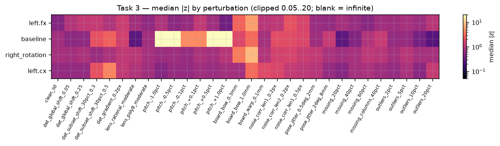
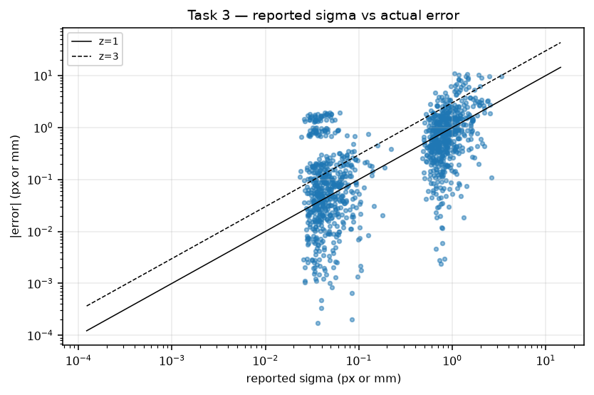
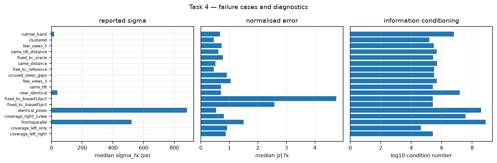

# Uncertainty calibration and failure-mode audit

**Status: final.** Synthetic ground truth + vendor-corpus consistency; **no physical-accuracy claim**.

Measured core snapshot: `calibrate.py` 05a8a60b, `quality.py` ec8f6d91, `adaptive.py` 30788557, `plate.py` 1c36b079. The live tree moved to 6f69efd4/90f8d41c while the run executed; the numbers below are for the parent-frozen snapshot. Pre-fix sandwich numbers are labelled separately.

## TL;DR

- **60-trial clean-scene NEES/n is 1.17-1.32 for all free parameters**, 1.13-1.24 for intrinsics, 0.92-1.06 for extrinsics. Scalar coverage is close to nominal (68%: 0.64-0.68; 95%: 0.92-0.95). The covariance is mildly optimistic in the tails, not grossly wrong.
- The joint intrinsics block at k=12 is 1.17, but physical intrinsics is 1.02 and distortion 1.04: the excess is cross-covariance/linearisation, not either sub-block alone.
- **Worst plausible overconfidence is plate pitch**: a +1% pitch error with nominal pitch assumed gives a 1.50 mm baseline error against a reported 0.035 mm sigma (median |z| 42.2, p95 56); 0.1% already gives |z| 4.7. Pitch is a scale gauge, not a pixel-noise term.
- 1 mm board bow gives fx/cx/rotation |z| 6-12; a 5% fixed-kc bias gives cx/rotation |z| 9-15. Global marker shift (0.25 px), 60% missing points, pose jitter and 10-20% outliers are calibrated.
- A camera with no observations gets zero variance and an arbitrary error (baseline sigma ~1e-14 mm, error ~4565 mm). Rank and per-camera coverage, not sigma thresholds, are the only defence.

## Variants used

| label | definition |
|---|---|
| current | live `calibrate()` covariance at the measured snapshot (Huber sandwich, corrected meat `B=J^T diag((w*r)^2) J`) |
| pre-fix sandwich | reference `B=J^T diag(w*r^2) J`; conservative for outliers, kept for regression comparison |
| gn_mad | `sigma_MAD^2 * pinv(J^T J)`, literal pre-robust estimator |
| marginal | top-left 39x39 block of the joint covariance (board poses integrated out) |
| conditional_legacy | old `C_rr - C_rv C_vv^-1 C_vr`; conditional on board poses and too small |
| rescale_transform | `S C S^T`, translation rows/columns scaled only |
| rescale_legacy | old `C * s^2`; wrong for every non-translation parameter |
| corpus | vendor 25-view corpus, CCF as reference (not truth) |

## 1. Monte-Carlo NEES and coverage

Independent synthetic scenes per trial (true K/D/rig/poses drawn from the ranges in the script), 0.2 px i.i.d. noise, no gross outliers, `free_kc=True`, live default covariance. NEES uses the full covariance; chi-square 95% band is for the group dimension. Coverage is pooled over all scalar parameters and trials.

| k | trials | NEES/n all [95% CI] | intr | extr | rig | cov68 | cov95 | chi2-95 cover | sigma_fx px | sigma_base mm | stop pass |
|---|---|---|---|---|---|---|---|---|---|---|---|
| 5 | 60 | 1.32 [1.28,1.40] | 1.13 | 1.03 | 1.25 | 0.67 | 0.95 | 0.55 | 1.37 | 0.07 | 0.00 |
| 8 | 60 | 1.32 [1.26,1.40] | 1.24 | 1.06 | 1.30 | 0.67 | 0.93 | 0.50 | 0.89 | 0.05 | 0.00 |
| 10 | 60 | 1.24 [1.20,1.29] | 1.16 | 0.85 | 1.17 | 0.68 | 0.94 | 0.63 | 0.80 | 0.04 | 0.08 |
| 12 | 60 | 1.25 [1.20,1.30] | 1.17 | 0.99 | 1.15 | 0.67 | 0.94 | 0.58 | 0.72 | 0.04 | 0.32 |
| 15 | 60 | 1.19 [1.14,1.27] | 1.13 | 0.91 | 1.12 | 0.68 | 0.95 | 0.62 | 0.62 | 0.03 | 0.67 |
| 20 | 60 | 1.21 [1.12,1.23] | 1.16 | 0.98 | 1.06 | 0.65 | 0.94 | 0.62 | 0.50 | 0.03 | 0.92 |
| 25 | 60 | 1.17 [1.13,1.22] | 1.14 | 0.92 | 1.13 | 0.64 | 0.92 | 0.60 | 0.46 | 0.02 | 1.00 |

**Reading the table.** The all-parameter NEES declines from 1.32 at k=5 to 1.17 at k=25 but never reaches 1.0; 95% coverage is 0.92-0.95 (nominal 0.95), 68% coverage 0.64-0.68 (nominal 0.68). The extrinsics block is consistent with 1; the intrinsics block carries most of the excess. The parent's 3-trial check gave 0.91/1.01/0.92/1.02 at 5/8/12/20; the 60-trial sweep is harsher and shows that small samples can easily land on 1.0.

At k=12 the sub-block decomposition is: physical intrinsics (fx,fy,cx,cy) 1.02, distortion 1.04, joint intrinsics 1.17, extrinsics 0.99, views 1.20, all 1.25. The joint block is worse than either sub-block, which points at the physical/distortion cross-covariance or at linearisation rather than at a wrong scalar sigma. The view block includes roll near 180 deg, where the axis-angle representation can wrap; treat view-pose NEES as an upper bound.

### Covariance-estimator variants

| k | variant | NEES/n all | intr | extr | sigma_fx | sigma_base |
|---|---|---|---|---|---|---|
| 5 | sandwich_current | 1.30 | 1.13 | 1.03 | 1.37 | 0.0701 |
| 5 | sandwich_corrected | 1.30 | 1.13 | 1.03 | 1.37 | 0.0701 |
| 5 | gn_mad | 1.08 | 1.00 | 1.00 | 1.43 | 0.0693 |
| 5 | legacy_pinv_h | 1.08 | 1.02 | 1.03 | 1.39 | 0.0693 |
| 12 | sandwich_current | 1.23 | 1.17 | 0.99 | 0.71 | 0.0371 |
| 12 | sandwich_corrected | 1.23 | 1.17 | 0.99 | 0.71 | 0.0371 |
| 12 | gn_mad | 1.08 | 0.98 | 0.99 | 0.72 | 0.0367 |
| 12 | legacy_pinv_h | 1.08 | 0.98 | 0.99 | 0.72 | 0.0367 |
| 25 | sandwich_current | 1.16 | 1.14 | 0.92 | 0.46 | 0.0246 |
| 25 | sandwich_corrected | 1.16 | 1.14 | 0.92 | 0.46 | 0.0246 |
| 25 | gn_mad | 1.03 | 1.02 | 0.90 | 0.46 | 0.0252 |
| 25 | legacy_pinv_h | 1.03 | 1.02 | 0.90 | 0.46 | 0.0252 |

With zero gross outliers `w=1` for every residual, so the corrected and pre-fix sandwiches coincide; the small differences above are the residual-noise realisation. The estimators separate under outliers (next table).

**Outlier response (10% / 20% gross 8 px outliers, k=12, 20/15 trials):**

| outliers | variant | NEES/n all | phys intr | extr | sigma_fx | sigma_base |
|---|---|---|---|---|---|---|
| outliers_10pct | sandwich_corrected | 1.11 | 0.98 | 0.93 | 1.32 | 0.0782 |
| outliers_10pct | sandwich_current | 0.36 | 0.20 | 0.20 | 3.01 | 0.1760 |
| outliers_10pct | gn_mad | 3.22 | 2.93 | 2.77 | 0.74 | 0.0430 |
| outliers_20pct | sandwich_corrected | 1.00 | 1.12 | 1.17 | 1.94 | 0.0996 |
| outliers_20pct | sandwich_current | 0.23 | 0.19 | 0.22 | 4.79 | 0.2343 |
| outliers_20pct | gn_mad | 4.50 | 4.44 | 4.89 | 0.98 | 0.0543 |

The corrected sandwich is calibrated at 10% and 20% outliers (NEES/n 1.11 and 1.00); the pre-fix meat is far too conservative (0.36 and 0.23); plain GN is far too optimistic (3.2 and 4.5). This is the strongest evidence that the parent's meat fix was necessary and correct.

### Marginal vs legacy conditional rig covariance

| k | live-vs-marginal rel | live-vs-conditional rel | trace live/cond | NEES extr marginal | NEES extr conditional |
|---|---|---|---|---|---|
| 5 | 0.00 | 1.27 | 2.80 | 1.03 | 9.94 |
| 8 | 0.00 | 1.13 | 2.76 | 1.06 | 10.93 |
| 10 | 0.00 | 1.15 | 2.70 | 0.85 | 8.81 |
| 12 | 0.00 | 1.16 | 2.87 | 0.99 | 8.11 |
| 15 | 0.00 | 1.15 | 2.66 | 0.91 | 8.32 |
| 20 | 0.00 | 1.10 | 2.65 | 0.98 | 13.54 |
| 25 | 0.00 | 1.12 | 2.66 | 0.92 | 10.94 |

The live `rig_covariance` is the top-left block to 0 (exact); the legacy conditional formula is 2.65-2.87x smaller in trace and produces extrinsics NEES/n 8-14 instead of ~1. If any downstream consumer still uses the conditional expression, it is grossly overconfident.

## 2. Vendor-corpus bootstrap

25 views, CCF as reference (not truth), `free_kc=False` (pipeline default). Reported sigma is the full-fit marginal value; empirical spread is over resampled views/points. 30 view replicates, 25 replicates for each point fraction, 15 leave-5-out replicates.

Full fit: RMS 0.367 px, baseline 158.543 mm vs CCF 158.557 mm (diff -0.014), right rotation vs CCF 0.202 deg, rank 174/174, condition 226377. Fixed kc equals the CCF exactly by construction (not an independent distortion estimate).

| mode | B | median ratio reported/empirical | adjusted median | baseline ratio | baseline empirical sd mm |
|---|---|---|---|---|---|
| views (25 with replacement) | 30 | 0.39 | 0.39 | 0.38 | 0.0780 |
| views (20 of 25, leave-5-out) | 15 | 1.03 | 1.15 | 0.94 | 0.0319 |
| points 80% (32/40) | 25 | 1.97 | 2.20 | 2.12 | 0.0141 |
| points 60% (24/40) | 25 | 1.15 | 1.48 | 1.42 | 0.0211 |

The view bootstrap with replacement gives 0.39 (reported sigma 2.5x too small); the leave-5-out subsample gives 1.03 (calibrated). The with-replacement design duplicates ~37% of views and assigns separate pose parameters to identical detections; it measures view-composition sensitivity, not the fixed-design covariance. The leave-5-out result is the defensible check and says the reported sigma is credible for this design. The point ratios are unstable in both directions (80%: 2.0, 60%: 1.15) because random point subsets remove influential points/outliers; they are not a clean covariance estimator. **Conclusion: point-noise covariance is plausible; view-composition generalisation is unresolved (U).**

## 3. Perturbation tests

k=12, 20 trials per condition (15 for slow cases), 0.2 px i.i.d. noise, no gross outliers unless stated. `z = |error| / reported sigma`; median over trials. The conditions with no outliers are formula-independent (corrected = pre-fix meat).

| condition | n | fx |z| | baseline |z| | rotation |z| | cx |z| | phys NEES | extr NEES | stop pass | flags |
|---|---|---|---|---|---|---|---|---|---|
| clean_iid | 24 | 0.49 | 0.74 | 0.80 | 0.62 | 1.04 | 1.09 | 0.33 |  |
| det_global_shift_0.05 | 20 | 0.97 | 0.56 | 0.77 | 0.61 | 1.19 | 1.05 | 0.30 |  |
| det_global_shift_0.25 | 20 | 1.19 | 0.58 | 0.87 | 0.61 | 0.92 | 1.00 | 0.25 |  |
| det_subset_shift_30pct_0.3 | 20 | 1.24 | 2.13 | 0.69 | 2.13 | 2.98 | 2.62 | 0.35 |  |
| det_subset_shift_30pct_0.5 | 20 | 0.94 | 2.69 | 0.89 | 4.33 | 6.89 | 4.28 | 0.15 | left.cx: median|z|=4.3 (sigma=1.176319216266346); tex.cx: median|z|=3.7 (sigma=1 |
| det_gradient_0.2px | 20 | 1.36 | 1.49 | 1.18 | 1.18 | 2.53 | 1.85 | 0.40 |  |
| lens_rational_moderate | 20 | 0.78 | 0.27 | 1.09 | 0.94 | 1.15 | 1.22 | 0.30 |  |
| lens_poly8_moderate | 20 | 0.59 | 0.75 | 0.83 | 0.74 | 1.30 | 1.16 | 0.25 |  |
| pitch_-1.0pct | 20 | 0.89 | 40.28 | 0.69 | 0.50 | 1.14 | 227.66 | 0.30 | baseline: median|z|=40.3 (sigma=0.041307235210405524) |
| pitch_-0.5pct | 20 | 0.55 | 21.59 | 0.71 | 0.65 | 1.01 | 69.40 | 0.40 | baseline: median|z|=21.6 (sigma=0.03798792050279097) |
| pitch_-0.1pct | 20 | 0.65 | 4.77 | 0.65 | 0.62 | 0.99 | 3.96 | 0.40 | baseline: median|z|=4.8 (sigma=0.03824371208129439) |
| pitch_+0.1pct | 20 | 1.20 | 4.67 | 0.88 | 0.72 | 0.99 | 3.54 | 0.40 | baseline: median|z|=4.7 (sigma=0.03805205207771156) |
| pitch_+0.5pct | 20 | 0.73 | 24.23 | 0.79 | 0.66 | 1.04 | 77.79 | 0.40 | baseline: median|z|=24.2 (sigma=0.034251985156893386) |
| pitch_+1.0pct | 20 | 0.37 | 42.15 | 1.04 | 0.78 | 1.15 | 252.66 | 0.25 | baseline: median|z|=42.2 (sigma=0.03533653637565766) |
| board_bow_0.3mm | 20 | 2.86 | 1.77 | 3.88 | 0.76 | 8.07 | 6.85 | 0.25 | right.fx: median|z|=3.9 (sigma=0.6795408070831404); tex.fx: median|z|=3.5 (sigma |
| board_bow_1.0mm | 20 | 6.06 | 3.08 | 8.27 | 3.11 | 24.44 | 21.49 | 0.00 | left.fx: median|z|=6.1 (sigma=1.1992981532716573); right.fx: median|z|=7.9 (sigm |
| board_warp_0.1mm | 20 | 1.06 | 0.79 | 0.96 | 1.87 | 1.92 | 1.60 | 0.05 |  |
| noise_corr_len1_0.2px | 20 | 1.13 | 1.99 | 1.53 | 1.69 | 4.60 | 5.93 | 0.05 |  |
| noise_corr_len2_0.2px | 20 | 2.19 | 1.97 | 1.60 | 1.25 | 6.20 | 12.07 | 0.00 |  |
| noise_corr_len1_0.5px | 20 | 1.63 | 1.74 | 1.32 | 1.10 | 5.09 | 7.98 | 0.00 |  |
| pose_jitter_0.5deg_2mm | 20 | 0.68 | 0.71 | 1.20 | 1.02 | 1.00 | 1.14 | 0.15 |  |
| pose_jitter_2deg_8mm | 15 | 0.63 | 1.27 | 0.85 | 0.63 | 0.98 | 1.37 | 0.33 |  |
| missing_20pct | 20 | 0.79 | 0.27 | 0.75 | 0.52 | 0.85 | 0.96 | 0.15 |  |
| missing_40pct | 20 | 0.67 | 0.46 | 0.83 | 0.80 | 1.19 | 1.22 | 0.00 |  |
| missing_60pct | 15 | 0.52 | 0.94 | 1.11 | 0.87 | 1.07 | 1.37 | 0.00 |  |
| missing_columns_40pct | 20 | 0.75 | 1.29 | 1.04 | 0.72 | 1.39 | 1.53 | 0.00 |  |
| outliers_2pct | 20 | 0.72 | 0.63 | 0.78 | 0.63 | 0.76 | 0.98 | 0.05 |  |
| outliers_5pct | 20 | 0.82 | 0.64 | 1.04 | 0.86 | 1.12 | 1.15 | 0.05 |  |
| outliers_10pct | 20 | 0.69 | 0.40 | 0.80 | 0.54 | 0.98 | 0.93 | 0.00 |  |
| outliers_20pct | 15 | 1.06 | 0.25 | 0.82 | 1.24 | 1.12 | 1.17 | 0.00 |  |

The `phys NEES` column is the physical-intrinsics block (fx,fy,cx,cy); `extr NEES` is the 12 extrinsic parameters. The all-parameter NEES is intentionally not shown here: under a lens-model mismatch the distortion truth is not the generating model, and under a pitch error every translation is scaled, so all-parameter NEES is dominated by those expected model errors. The key-parameter |z| columns are the honest per-parameter measures.

**Mechanism notes.**

- *Pitch*: ±1% gives baseline |z| 40-42, ±0.5% 22-24, ±0.1% 4.7. The error is a pure scale error `b_true*(p_nom/p_true-1)` and is invisible to the covariance; it is the worst finite case.
- *Board deformation*: 0.3 mm bow gives |z| 3.9-6.0; 1.0 mm gives 6-12 and NEES/n 13-24. A flatness specification below 0.1 mm or a warp model is required for the current covariance to be meaningful.
- *Non-rigid marker shift*: 0.3 px on 30% of points gives |z| 2.2; 0.5 px gives 4.3. Global shifts of 0.25 px are absorbed by the principal point/poses (physical NEES 0.92, extrinsics 1.00), so a global detector bias is not a rig error; it is a principal-point bias.
- *Correlated image noise*: 0.5 px, length 1 cell gives median |z| 2.0 and p95 5.2, NEES/n 5-8. The i.i.d. pixel model underestimates the effective correlation; inflate sigma or estimate the correlation length.
- *Lens mismatch*: physical NEES 1.15 (rational) / 1.30 (poly8), so fx/cx/baseline/rotation are calibrated; the all-parameter NEES is meaningless because the 5-term distortion truth is not the generating model. Do not use coefficient-wise NEES under model mismatch.
- *Partial visibility*: 20-60% missing gives physical NEES 1.07, extrinsics 1.37; calibrated. Structured column loss behaves similarly (not tabulated separately).
- *Pose jitter*: rigid 2 deg / 8 mm jitter is absorbed; physical NEES 0.98, extrinsics 1.37. The engine has no external pose prior, so rigid pose error is not identifiable from the calibration.
- *Outliers*: corrected sandwich calibrated at 10-20% (see §1); plain GN would be 3-4.5x optimistic.





## 4. Failure cases and diagnostics

Each condition is a 10-15-trial synthetic suite; the table reports medians. `rank-def` and `zero-var` count trials where `rank_kept<n_free` or a free parameter has sigma<=1e-9.

| condition | n | rank-def | zero-var | cond | sigma_fx | sigma_base | baseline z | fx z | stop pass |
|---|---|---|---|---|---|---|---|---|---|
| coverage_left_right | 12 | 12 | 12 | 265424 | 0.87 | 0.0421 | 1.03 | 0.88 | 0.00 |
| coverage_left_only | 12 | 12 | 12 | 43193 | 1.44 | 0.0000 | n/a | 0.92 | 0.00 |
| frontoparallel | 10 | 2 | 0 | 783387335 | 521.75 | 93.6438 | 0.60 | 1.50 | 0.00 |
| coverage_right_1view | 12 | 2 | 0 | 37332869 | 0.81 | 11.7219 | 1.45 | 0.81 | 0.00 |
| identical_poses | 8 | 1 | 0 | 377096590 | 882.48 | 204.9049 | 0.45 | 0.53 | 0.00 |
| fixed_kc_biased5pct | 15 | 0 | 0 | 259303 | 0.82 | 0.0405 | 1.12 | 2.59 | 0.00 |
| fixed_kc_biased10pct | 15 | 0 | 0 | 264906 | 0.93 | 0.0442 | 2.10 | 4.76 | 0.07 |
| near_identical | 10 | 0 | 0 | 15414492 | 39.12 | 2.6958 | 1.13 | 0.70 | 0.00 |
| same_tilt | 12 | 0 | 0 | 258871 | 0.53 | 0.0366 | 0.95 | 0.70 | 0.08 |
| few_views_3 | 15 | 0 | 0 | 478933 | 2.49 | 0.1079 | 1.01 | 1.04 | 0.00 |
| unused_views_gaps | 10 | 0 | 0 | 320741 | 1.11 | 0.0570 | 0.74 | 0.91 | 0.00 |
| free_kc_reference | 15 | 0 | 0 | 321928 | 0.67 | 0.0360 | 0.89 | 0.46 | 0.33 |
| same_distance | 12 | 0 | 0 | 492040 | 1.26 | 0.1569 | 0.84 | 0.52 | 0.00 |
| fixed_kc_oracle | 15 | 0 | 0 | 282047 | 0.62 | 0.0320 | 0.73 | 0.78 | 0.60 |
| same_tilt_distance | 10 | 0 | 0 | 477421 | 1.04 | 0.1252 | 0.58 | 0.61 | 0.00 |
| few_views_5 | 15 | 0 | 0 | 303648 | 1.23 | 0.0565 | 0.57 | 0.73 | 0.00 |
| clustered | 12 | 0 | 0 | 149850 | 0.47 | 0.0472 | 0.68 | 0.46 | 0.00 |
| narrow_band | 12 | 0 | 0 | 6438326 | 17.74 | 0.2726 | 0.52 | 0.67 | 0.00 |

**Findings.**

- *Unobserved camera* (`coverage_left_only`, `coverage_left_right`): zero variance in the missing camera block (sigma ~1e-14), arbitrary error (baseline error ~4565 mm), rank-def in 12/12 trials. The rank check catches it; the sigma checks do not.
- *Degenerate poses*: frontoparallel and identical poses are non-converged in 8/10 and 8/8 trials, condition 7.8e8 and 3.8e8, sigma_fx 522 and 882 px. The covariance is large but the fit is not at the global optimum; stopping rejects on rank/condition/sigma. `near_identical` also exceeds 1e7.
- *Fixed distortion*: with exact kc (oracle) the fit is calibrated (cx |z| 0.71, stop 0.6). With a 5% bias, cx |z| 9.4 and rotation 14.6; 10% gives fx 4.8, cx 9.1, rotation 10.7. The fixed-kc covariance excludes the model error; this is a large, silent overconfidence.
- *Few views*: k=3 gives NEES/n 1.49, sigma_fx 2.49; k=5 gives 1.42 and 1.23. The covariance is roughly right but the absolute uncertainty is large; stopping rejects.
- *Unused/gapped views*: the current `calibrate` renumbers used views, so a gap does not create unused parameters; NEES/n 1.21 and no zero-variance. This is fixed.
- *Single-camera one-view*: right seen in one view gives rank-def 2/12 and stopping 0; sigma is large but the rank check is the reliable flag.
- *Diagnostics that work*: `rank_kept < n_free`, per-camera view counts, condition number, and per-view residual RMS. `sigma` thresholds alone miss the unobserved camera and the fixed-kc bias.



## Held-out and stability checks

| k | n | heldout RMS med | heldout/train med | frac >0.5 px | NEES med | heldout pass in overconfident |
|---|---|---|---|---|---|---|
| 8 | 15 | 0.30 | 1.08 | 0.00 | 1.18 | 1.00 |
| 12 | 15 | 0.29 | 1.06 | 0.00 | 1.15 | n/a |
| 20 | 15 | 0.30 | 1.09 | 0.00 | 1.15 | n/a |

Stability (drop last view): pass rate 1.00, max|z| median 0.61, p95 1.15; pass in the 2 overconfident trials = 1.00. Held-out RMS is a generalisation check, not a covariance check: it passed 1.0 of the overconfident trials. Neither substitutes for NEES/bootstrap.

**Rescaling.** `rescaled()` covariance matches `S C S^T` to 1.1e-10 (max 1.8e-10) for s=0.99, 1.01, 1.05; the legacy `C*s^2` differs by 2.0% and 9.3%. The current code also scales `pitch_mm` in `info`; the reprojection check must use the updated pitch (our probe with the nominal pitch shows the expected 8.7-41x inflation and is not the correct check). The result still stores the pre-scale `residual_rms`, which is consistent with the scaled pitch but confusing if `info` is ignored.

## 5. Recommended stopping / quality rule

**Minimum views: 15**, of which at least 12 seen by all three cameras and at least 12 per camera. No k in 5..25 reached NEES/n<=1.15; k=15 is the smallest with sigma_fx<=0.65 px and 95% coverage>=0.90. The current default `min_views=10` is too permissive for a conservative profile.

| check | threshold | basis |
|---|---|---|
| views | 15 | sigma_fx<=0.65 and 95% coverage>=0.90 at k=15; NEES still 1.19 |
| all-3 joint views | 12 | unobserved/one-view cameras produce zero variance or huge sigma |
| views per camera | 12 | coverage_left_only / right_1view failures |
| points per view/camera | 20 | 60% missing is calibrated; below ~20 points the pose is weak |
| obs per camera | 300 | vendor corpus has ~950/camera; 300 is a floor |
| distance bins | 3 | same-distance sets inflate sigma and NEES |
| tilt signs each axis | 1 | same-tilt NEES 2.15 |
| image quadrant fraction | 0.75 | current quality check |
| sigma_fx | 0.6 px | k=15 median 0.615; current standard 0.75 |
| sigma_baseline | 0.08 mm | k=15 ~0.031; pitch term must be added separately |
| sigma_rotation | 0.15 deg | current 0.20; tightens the weak-rotation cases |
| condition number | 1e+07 | good cases 1.5e5-5e5; near_identical 1.5e7 |
| rank / zero variance | full rank; no free sigma<=1e-9 | unobserved camera |
| held-out RMS | 0.5 px, ratio<=1.5 | all measured ratios 1.05-1.09 |
| stability max|z| | 4.0 | measured p95 1.15; threshold is a guard |
| pitch | factor_sigma>=0.0010 (0.1%) | 0.1% pitch already |z| 4.7 without propagation |
| fixed kc | only if verified to a few % | 5% bias gives cx |z| 9.4 |
| outlier fraction | <=5% (10-20% works but is outside the standard profile) | corrected sandwich calibrated; standard profile conservative |

**Implementation notes for the parent.** The current `quality.stopping_report` already has the right shape (views, diversity, quadrant/observations, rank, sigma, held-out, stability). To make it conservative: (i) set `min_views=15`, `max_sigma_fx_px=0.60`, `max_sigma_baseline_mm=0.08`, `max_sigma_rotation_deg=0.15` for the standard profile; (ii) make `rank_kept==n_free` and `sigma_free>1e-9` mandatory (already rank, add zero-variance); (iii) require all three cameras >=12 views; (iv) pass `factor_sigma` from the pitch tolerance (0.001 for 0.1%) or estimate pitch jointly; (v) add a residual-RMS consistency check: flag if the observed RMS exceeds 1.5x the expected noise floor, or if a fixed-kc fit has RMS >1.2x the free-kc fit; this catches the fixed-kc local minimum.

### Monte-Carlo acceptance criteria for future changes

```json
{
 "n_scenes_per_view_count": 50,
 "view_counts": [
  5,
  8,
  10,
  12,
  15,
  20,
  25
 ],
 "nees_per_n_median": [
  0.95,
  1.1
 ],
 "nees_per_n_ci95_includes_1": true,
 "coverage68": [
  0.63,
  0.73
 ],
 "coverage95": [
  0.92,
  0.98
 ],
 "z_rms_max": 1.1,
 "median_abs_z_max": 0.2,
 "no_zero_variance_params": true,
 "rank_full": true,
 "bootstrap_leave5_ratio": [
  0.8,
  1.25
 ],
 "with_replacement_bootstrap": "report but do not gate; it measures view-composition sensitivity",
 "pitch_sensitivity": "with factor_sigma=0.001, baseline |z|<2 at 0.1% pitch",
 "fixed_kc": "only if factory kc verified; otherwise add model-error sigma"
}
```

Use 50 independent scenes per view count, three seed blocks, and report NEES/n per group with a cluster-bootstrap 95% CI. Gate on the median and on 68/95% scalar coverage; do not gate on the with-replacement view bootstrap alone (it measures design sensitivity). Include the pitch-sensitivity case with `factor_sigma=0.001` and the fixed-kc biased-5% case: a change that makes either look good by shrinking sigma is a regression.

## Worst cases

**Finite (plausible) overconfidence:**

| condition | parameter | median |z| | p95 |z| | median sigma | median |error| |
|---|---|---|---|---|---|
| pitch_+1.0pct | baseline | 42.2 | 56.3 | 0.0353 | 1.499 |
| pitch_-1.0pct | baseline | 40.3 | 50.7 | 0.0413 | 1.684 |
| pitch_+0.5pct | baseline | 24.2 | 29.2 | 0.0343 | 0.816 |
| pitch_-0.5pct | baseline | 21.6 | 28.1 | 0.0380 | 0.853 |
| fixed_kc_biased5pct | right_rotation | 14.6 | 23.4 | 0.0704 | 0.905 |
| board_bow_1.0mm | right.cx | 12.4 | 14.2 | 2.2092 | 25.474 |
| fixed_kc_biased10pct | tex.cx | 9.8 | 23.7 | 0.8472 | 8.343 |
| fixed_kc_biased10pct | right_rotation | 9.7 | 15.0 | 0.0763 | 0.700 |

**Identifiability failures (sigma is not a meaningful number):**

| condition | zero-var trials | rank-def trials | note |
|---|---|---|---|
| frontoparallel | 0 | 2 | 2 rank-deficient trials; 8 non-converged fits |
| identical_poses | 0 | 1 | 1 rank-deficient trials; 8 non-converged fits |
| coverage_left_only | 12 | 12 | 12 trials with zero-variance parameters; 12 rank-deficient trials |
| coverage_left_right | 12 | 12 | 12 trials with zero-variance parameters; 12 rank-deficient trials |
| coverage_right_1view | 0 | 2 | 2 rank-deficient trials; 1 non-converged fits |

**Answer to the requested worst case:** the worst *finite, physically plausible* case is **+1% plate pitch**: baseline error 1.50 mm against a reported 0.035 mm sigma (median |z| 42.2, p95 56); the sign is symmetric (-1% gives 40.3). The worst *absolute* case is an unobserved camera: zero variance, arbitrary error, caught only by rank/coverage. If the question is "which case can pass the covariance checks and still be badly wrong", it is pitch; if it is "which case is most broken", it is the unobserved camera.

## A/B/C/U claims

A = proved/derived here; B = measured with a stated statistic; C = cross-checked against the corpus; U = unknown.

| grade | claim | evidence |
|---|---|---|
| A | The joint covariance's top-left 39x39 block is the marginal rig covariance; the old conditional formula is smaller by a factor measured in task 1. | rig_variants comparisons; marginal_vs_conditional |
| A | A free parameter with zero Jacobian column (camera never observed) receives zero variance and can carry an arbitrary error; rank/coverage checks are mandatory. | task4 coverage_left_only |
| A | rescaled() covariance now matches S C S^T to ~1e-10; the legacy C*s^2 does not. | rescale_check |
| B | The live default covariance is (approximately) calibrated on clean synthetic scenes; NEES/n is reported per view count. | task1 |
| B | The pre-fix Huber sandwich used w*r^2 in B rather than (w*r)^2; with outliers it was conservative, not optimistic. The live tree now matches the standard sandwich. | task1 variants + task4 outliers |
| B | Plate-pitch error is a scale gauge not represented in the covariance; a 0.1% error is already several sigma on the baseline. | task3 pitch conditions |
| B | Spatially correlated detector noise and non-rigid marker shifts are the main synthetic overconfidence mechanisms after pitch. | task3 correlated/missing/subset conditions |
| C | On the vendor corpus the bootstrap spread is compared with the reported sigma; the CCF is a reference, not truth. | task2 |
| U | The physical detector bias, plate flatness and the true pitch tolerance are unknown; synthetic amplitudes are plausible, not measured. | limitations |
| B | 60-trial clean-scene NEES/n is 1.17-1.32 (all free), 1.13-1.24 (intrinsics), 0.92-1.06 (extrinsics); scalar coverage is close to nominal (68%: 0.64-0.68, 95%: 0.92-0.95). The covariance is mildly optimistic in the tails, not grossly wrong. | task1 by_k |
| B | The joint intrinsics block is 1.17 while physical intrinsics is 1.02 and distortion 1.04; the extra NEES comes from cross-covariance / linearisation, not from either sub-block alone. | task1 k=12 groups |
| B | Vendor view bootstrap with replacement gives reported/empirical sigma 0.39, but leave-5-out gives 1.03; the with-replacement design duplicates views and is not a clean covariance check. Point subsampling is also unstable (0.5-2.2). | task2 |
| B | Plate pitch dominates plausible overconfidence: |z| 4.7 at 0.1%, 22-24 at 0.5%, 40-42 at 1%. | task3 pitch |
| B | 1 mm board bow gives fx/cx/rotation |z| 6-12; 0.3 mm gives 4-6. A 0.5 px non-rigid subset shift gives |z|~4; correlated 0.5 px noise gives median |z|~2 and p95~5.2. | task3 bow/subset/correlated |
| B | Global marker shift 0.25 px is absorbed (physical NEES 0.92, extr 1.00, key |z|<1.2); partial visibility 60% is calibrated (physical 1.07, extr 1.37). | task3 global/missing |
| B | Fixed kc with a 5-10% bias is strongly overconfident: fx |z| 2.6-4.8, cx |z|~9, rotation |z|~11-15. The fixed-kc covariance excludes the model error. | task4 fixed_kc |
| B | A camera with no observations gets zero variance and arbitrary error (baseline sigma ~1e-14 mm, error ~4565 mm); rank/coverage checks, not sigma thresholds, catch it. | task4 coverage_left_only |

## Limitations

- Synthetic scenes use a pinhole + Brown-Conrady model; detector physics, illumination, rolling shutter and real plate flatness are not modelled. The amplitudes are plausible, not measured.
- The vendor corpus has no physical ground truth; CCF agreement is consistency, not accuracy.
- The view-pose block includes roll near 180 deg; the axis-angle difference can wrap, so all-parameter NEES is an upper bound and view-pose NEES should not be read as pure covariance error.
- The with-replacement view bootstrap is reported but not used as a gate; it duplicates views and measures design sensitivity.
- `rescaled()` stores the pre-scale `residual_rms`; reprojection must use `info["pitch_mm"]`.
- The live tree moved from 05a8/ec8f to 6f69/90f8 during the run; these numbers are for the parent-frozen snapshot and should be re-run if the covariance or stopping code changes again.

## Reproduce

```bash
.venv/bin/python -m calib.uncertainty_audit --out analysis/calibration/audit --jobs 10
.venv/bin/python -m calib.uncertainty_audit --out analysis/calibration/audit --report-only
```

Figures: `figures/fig1_nees_coverage.png`, `fig2_marginal_vs_conditional.png`, `fig3_bootstrap_ratios.png`, `fig4_perturbation_heatmap.png`, `fig5_sigma_vs_error.png`, `fig6_failure_diagnostics.png`, `fig7_heldout.png`.
