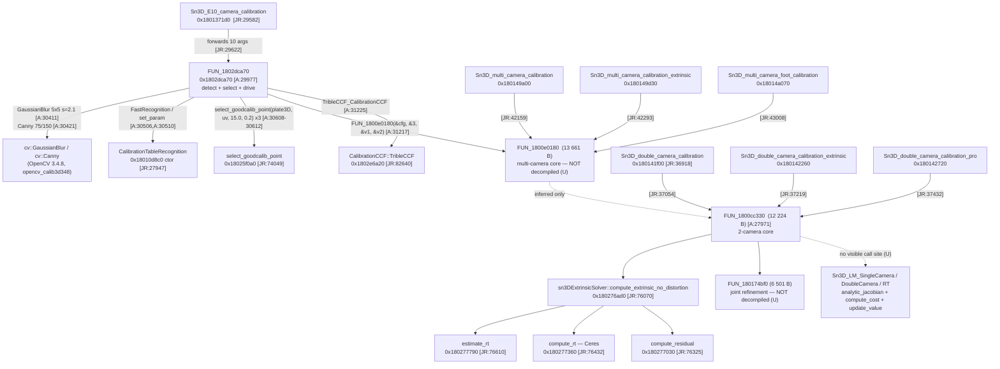

# Einstar / EXStar 1.2.2.0 — calibration math in `Sn3DCalibrationJR.dll`

Static, offline, read-only analysis of the Ghidra 12.1.4 decompiler dumps (image base `0x180000000`).
No binary was executed and no vendor file was modified.

## 0. Evidence, citation scheme, confidence scale

| tag | file |
|---|---|
| `[JR:NNNN]` | `analysis/calibration/ghidra/dumps/Sn3DCalibrationJR.dump.txt` |
| `[A:NNNN]` | `analysis/calibration/ghidra/dumps/JR_addrs.dump.txt` (10 extra functions, full bodies) |
| `[W:NNNN]` | `analysis/calibration/ghidra/dumps/Sn3DCalibrateAlgorithmWrapper.dump.txt` |
| `[C:NNNN]` | `analysis/calibration/ghidra/dumps/Sn3DCameraCalibHelper.dump.txt` |
| `[E:NNNN]` | `analysis/calibration/ghidra/dumps/Sn3DEACalibrateController.dump.txt` |
| `[D:NNNN]` | `analysis/calibration/ghidra/dumps/Sn3DCalibDevFile.dump.txt` |

Confidence: **A** = read directly out of decompiled arithmetic / RTTI / symbol table, cross-checked on ≥ 2
independent call sites; **B** = single site, or the value requires one standard convention assumption;
**C** = inference from layout/idiom, not proved; **U** = unresolved (evidence not in the dumps).

Method note: all 21 011 JR symbols are in the FUNCTIONS table `[JR:500-21044]`, all 2 901 strings in
`[JR:21044-23946]`, string xrefs in `[JR:23946-27946]`, and 537 function bodies in `[JR:27946-137626]`.
The dump has **no call-xref table**; call edges below were recovered by scanning the 537 bodies for call
tokens (wrapped lines included).

---

## 1. Call graph — what the binary actually does



### 1.1 Proven call path

1. **`Sn3D_E10_camera_calibration`** (`0x1801371d0`, 231 B) is a pure forwarder. Body `[JR:29592-29625]`:
   copies the by-value `Sn3DCalibrationOpt` into a local (`FUN_18010fd50`, `[JR:29616]`), forwards all ten
   arguments plus that copy to `FUN_1802dca70` (`[JR:29622]`), then destroys the copy (`[JR:29623]`).
   Demangled signature (llvm-undname):
   `RetVal(const vector<Vector3d>&, const vector<Vector2i>&, const vector<uchar*>&, const vector<uchar*>&,
   const vector<uchar*>&, vector<double>&, CalibParam&, CalibParam&, CalibParam&, Sn3DCalibrationOpt)`.
   The second argument is **not** 2-D points: `FUN_1802dca70` requires exactly 3 elements (`[A:30369]`) and reads each
   as `(int width, int height)` when it builds `cv::Mat` (`[A:30622-30623]`), i.e. it is
   the (W,H) of the left/right/tex sensors. The 2-D image points are produced **inside** the driver by the
   recognition stage.

2. **`FUN_1802dca70`** (10 params `[A:29982-29984]`) is the E10 driver:
   - validates `nImages == nPoints`-style invariants per camera (`[A:30363-30380]`);
   - builds a `cv::Mat` per image from the raw `uchar*` arrays and never re-uses them
     (`error_cv "total() == 0 || data != NULL"` guards `[A:30638-30651]`);
   - `GaussianBlur(..., Size(5,5), sigma=2.1)` `[A:30411]`, `Canny(..., 75.0, 150.0)` `[A:30421]`;
   - `FastRecognition` ctor + `set_param(CvCannyParam, GuassFilterParam, EllipseParam, …)`
     `[A:30506] [A:30510]`, then a **TBB `parallel_for`** over images `[A:30571-30605]` whose body calls
     `select_goodcalib_point(plate3D, uv_cam, 15.0, 0.2)` once per camera `[A:30608-30612]`
     (constants `0x402e000000000000` = 15.0, `0x3fc999999999999a` = 0.2);
   - writes debug renderings `../outImg/out_L_<i>.png`, `out_R_…`, `out_M_…` `[A:30794,30907,31021,30840]`
     (`cvtColor` + `draw_markers` + `imwrite`, `[A:30756-30775]`);
   - hands off to the multi-camera core with a small option block built at `[A:31196-31208]`:
     `0.8`, `5.5`, `5.0/nImages`, `nCams = 3`, `true`, and `FUN_1800e0180(&cfg, &nCams, &out1, &out2)`
     `[A:31217]`;
   - on `ret == 0` calls `TribleCCF_CalibrationCCF(&…,&…,&…,&…)` `[A:31225]` to fill the three `CalibParam`
     records; on failure prints `" check input! "` `[A:31298]`.

3. **`FUN_1800e0180`** (0x1800e0180, 13 661 B) is the **multi-camera (3-camera) core** used by E10. It is
   called from exactly four places: the E10 driver `[A:31217]` and `Sn3D_multi_camera_calibration[_extrinsic]`
   / `Sn3D_multi_camera_foot_calibration` `[JR:42159, 42293, 43008]`. **It is not present in the 537
   decompiled bodies** — neither in `Sn3DCalibrationJR.dump.txt` nor in `JR_addrs.dump.txt`.

4. **`FUN_1800cc330`** (12 224 B) is the **two-camera core**, reached only through
   `Sn3D_double_camera_calibration` `[JR:37054]`, `…_extrinsic` `[JR:37219]`, `…_pro` `[JR:37432]`.
   Its callees are `sn3DExtrinsicSolver` (`[A:28552]`), `compute_extrinsic_no_distortion` (twice, one per
   camera: `[A:28594]` and `[A:28735]`), `Rodrigues` (`[A:28970]`, `[A:29001]`), and two calls into
   `FUN_180174bf0` (`[A:28886]`, `[A:28895]`).

> **Correction to the task premise.** The chain is *E10 → FUN_1802dca70 → FUN_1800e0180 (multi-camera) →
> TribleCCF*, **not** *→ FUN_1800cc330*. `FUN_1800cc330` is the 2-camera sibling used by the
> `Sn3D_double_camera_calibration*` API family. Whether `FUN_1800e0180` itself calls `FUN_1800cc330`
> cannot be decided from these dumps (no call-xref table, body not decompiled) — **U**. Everything below
> about solver structure is therefore proved for the 2-camera core and marked where it is only likely for
> the 3-camera path.

---

## 2. Camera model (proved, A)

### 2.1 Projection — `Sn3D_camera_to_image` (`0x18013d3f0`, `[JR:33529]`)

Five-parameter intrinsic vector `K5` and five-parameter distortion vector `D5`. The pixel equations are
literally `[JR:33600-33601]`:

```c
*param_4   = K[4]*K[0]*yd + xd*K[0] + K[1];   // u = fx*(xd + alpha*yd) + cx
 param_4[1]= yd*K[0]*K[3]        + K[2];      // v = fx*aspect*yd    + cy
```

with `xd,yd` the **distorted** normalized coordinates from `FUN_1800beed0` (`[A:27947-27965]`,
called at `[JR:33585]`). Hence

```
K5 = [ fx, cx, cy, fy/fx, alpha ]          (alpha = CC-toolbox alpha_c, dimensionless)
u  = fx*(x_d + alpha*y_d) + cx
v  = fy*y_d + cy                           (fy = fx * K5[3])
```

This is the *inverse* of what `compute_extrinsic_no_distortion` does when it normalizes observations
(`[JR:76230-76245]`):

```c
x' = (u - K[1]) / K[0];
y' = (v - K[2]) / (K[0]*K[3]);
x  = x' - y'*K[4];        // undo skew
```

Three independent sites agree on the layout (`camera_to_image`, `compute_extrinsic_no_distortion`,
`TribleCCF` `fy = K5[3]*K5[0]` `[JR:82428]`) ⇒ **A**.

### 2.2 Distortion polynomial (A)

`FUN_1800beed0(double* k, const double* xy, double* out)` `[A:27947]`, verbatim:

```c
r2 = x*x + y*y;
out[0] = (r2*k[1]*r2 + r2*k[0] + 1.0 + r2*k[4]*r2*r2) * x
       + (k[2]+k[2])*x*y + ((x+x)*x + r2)*k[3];
out[1] = (r2*k[1]*r2 + r2*k[0] + 1.0 + r2*k[4]*r2*r2) * y
       + (k[3]+k[3])*x*y + ((y+y)*y + r2)*k[2];
```

i.e. Brown–Conrady / OpenCV 5-term:

```
x_d = x*(1 + k1 r^2 + k2 r^4 + k3 r^6) + 2 p1 x y + p2 (r^2 + 2x^2)
y_d = y*(1 + k1 r^2 + k2 r^4 + k3 r^6) + p1 (r^2 + 2y^2) + 2 p2 x y
D5  = [k1, k2, p1, p2, k3]
```

Distortion is applied in **normalized** coordinates, before the affine `K5` map (no `fx` inside the
polynomial) ⇒ units are `1/mm`-free, `k1..k3` dimensionless, `p1,p2` dimensionless, image coordinates in
**pixels**, object/translation units in **millimetres** (see §6). No rational model is used by the
calibration path (the `Rational18/30/45Distortion` classes exist but are only referenced by their own
`unDistortion`, `[JR:74781/74857/74933]`).

### 2.3 Where the 3×3 K lives

There is no explicit 3×3 `K` in the solver; the code carries `K5` and expands on demand:
`fx=K5[0]`, `fy=K5[0]*K5[3]`, `cx=K5[1]`, `cy=K5[2]`, skew `alpha=K5[4]` (applied as `fx*alpha*y`).
`CameraGeometry<RadialDistortion>` and `CameraCalibrationParam<…>` exist but are used by the
reconstruction/ray code, not by the fitting loop.

---

## 3. Parameter vectors (A)

### 3.1 Solver state of the hand-written LM (`Sn3D_LM_DoubleCamera::update_value`, `[JR:117553]`)

Unpacking order read off the stores at `[JR:117565-117700]`:

| slice | count | meaning |
|---|---|---|
| `x[0..4]` | 5 | `K5` camera A |
| `x[5..9]` | 5 | `D5` camera A |
| `x[10..14]` | 5 | `K5` camera B |
| `x[15..19]` | 5 | `D5` camera B |
| `x[20+6v .. 25+6v]` | 6·V | per view: `rvec(3)`, `tvec(3)` (board→camera A) |
| next 6 | 6 | **relative pose** `rvec_rel(3)`, `tvec_rel(3)` (A→B) |
| next 3·N | 3·N | 3-D reference points |

`Sn3D_LM_SingleCamera` uses the same layout minus camera B and minus the relative pose, i.e.
`[K5, D5, {rvec,tvec}×V, X×N]` (`[JR:115790-115830]`, first state index `iVar13 = 10`).

The object points are **free variables** and are marked invalid by negative coordinates: the residual loop
skips a point when `x<0 or y<0` (`[JR:115867]` `if (0.0 < *pdVar2 || *pdVar2 == 0.0)`), which is how the
`(-1,-1,-1)` sentinel propagates.

### 3.2 `CalibParam` — the 23-double in-memory record (A)

`Sn3DAlgorithm::CalibParam` is registered as a Qt metatype with size **0xB8 = 184 B = 23 doubles**
(`QMetaType::registerNormalizedType(..., 0xb8, ...)` at `[W:55242]`). Field offsets are read off the
writes in `CalibrationCCF::TribleCCF` `[JR:82428-82460]`:

| off | field | source in TribleCCF |
|---|---|---|
| `+0x00` | *not written here* — U (likely `error`/validity) | — |
| `+0x08` | `fx` | `K5[0]` `[JR:82427]` |
| `+0x10` | `fy` | `K5[3]*K5[0]` `[JR:82428]` |
| `+0x18` | `cx` | `K5[1]` `[JR:82429]` |
| `+0x20` | `cy` | `K5[2]` `[JR:82430]` |
| `+0x28..0x48` | `kc[0..4]` = `k1,k2,p1,p2,k3` | `D5[0..4]` `[JR:82434-82444]` |
| `+0x50` | `alpha` | `K5[4]` `[JR:82431]` |
| `+0x58..0x9F` | `R[9]` **row-major** | `Rodrigues(rvec)` `[JR:82463-82486]` |
| `+0xA0..0xB7` | `T[3]` (mm) | first valid view's `tvec` `[JR:82487-82490]` |

### 3.3 CCF output — 33 doubles, MATLAB `Calib_Results` order (A/B)

`CalibrationCCF::WriteCcf` writes the *text* twin of the record and fixes the semantic order
`[JR:82994-83012]`:

```
fc = [fx fy]   cc = [cx cy]   alpha   kc = [k1 k2 p1 p2 k3]   T = [3]   R = [9]   error
```

Packed as `fc[2] _pad[2] cc[2] _pad[2] alpha _pad kc[5] _pad[5] T[3] R[9] error` = 33 doubles
(this matches `docs/calibration/ccf_format.md` §3, which proves the binary layout independently).
`R` is row-major world→camera, `X_cam = R·X_world + T`, no transpose anywhere in the writers
`[JR:83010]`; the IR-only 256-byte trailer is appended by the device-file layer, not here.

---

## 4. Solvers

### 4.1 Ceres problem — per-view extrinsic (`sn3DExtrinsicSolver::compute_rt`, `0x180277360`, `[JR:76432]`)

```
sn3DExtrinsicSolver::compute_rt(const vector<Vector2d>& img, const vector<Vector3d>& obj,
                                Matrix<double,3,1>& rvec, Matrix<double,3,1>& tvec) -> int
```

Guards: `img.size() == obj.size()` and `size > 3` (`[JR:76491]`), else `"Error: input is illegal"` `[JR:76599-76603]`.
Initial value: `tvec[0] += 100.0` (`local_60 = *param_5 + 100.0;` `[JR:76495]`), `rvec` unchanged.

Per correspondence `[JR:76505-76564]` (`do { … } while (i < n)` at `[JR:76506]`):

```c
CostFunctor* f = new (0x30)              // 6 doubles: obj(3) + img(2) + pad
f->vftable = SizedCostFunction<2,3,3,...>            // [JR:76529]
f->set_num_residuals(2);                             // [JR:76530]
f->mutable_parameter_block_sizes() = {3, 3};        // [JR:76537, JR:76547]
f->vftable = AutoDiffCostFunction<sn3DExtrinsicSolver_CostFunctor,2,3,3,...> // [JR:76549-76550]
problem.AddResidualBlock(f, /*loss=*/0, &rvec, &tvec);        // [JR:76556-76557]
```

| property | value | cite |
|---|---|---|
| residual blocks | one per 3-D/2-D correspondence | `[JR:76506-76564]` |
| residuals per block | **2** (u,v reprojection, pixels) | `[JR:76529-76530]` |
| parameter blocks | `rvec` (3), `tvec` (3) | `[JR:76537/76547]`, `[JR:76556]` |
| loss function | **none** — literal `0` passed | `[JR:76557]` |
| local parameterization | none (rvec is a free 3-vector, not a quaternion) | — |
| `bounds`/`SetParameterBlockConstant` | none in this function | — |
| initial guess | `rvec` from `estimate_rt`, `tvec.x += 100` mm | `[JR:76495]` |

`ceres::Solver::Options` is default-constructed and exactly **two** fields are written
`[JR:76566-76568]`:

```
__0Options_Solver_ceres__QEAA_XZ(local_228);   // Options ctor
local_1c0 = 100;                               // 4-byte store at Options+0x68
local_f8  = 0;                                 // 1-byte store at Options+0x130
```

`local_228` is the `Options` object (`undefined1 local_228[104]` `[JR:76469]`), so the writes are at
`Options+0x68` (int) and `Options+0x130` (bool). No `linear_solver_type`, no `num_threads`,
no `function/gradient/parameter_tolerance`, no `minimizer_progress_to_stdout` is set ⇒
**Ceres defaults** (`DENSE_QR`, `num_threads=1`, `max_num_iterations=50`, tolerances `1e-6/1e-10/1e-8`).

| field | offset written | value | likely meaning | conf. |
|---|---|---|---|---|
| `max_num_iterations` | `+0x68`, 4 B | `100` | iteration cap raised 50→100 (natural source line `options.max_num_iterations = 100;`) | **C** — the exact Ceres version's `Solver::Options` layout is not recoverable offline (no `ceres.dll` in the tree) |
| `use_nonmonotonic_steps` (or another bool) | `+0x130`, 1 B | `0` | explicitly set false (default anyway) | **C** |

Success test: `if (summary.termination_type == 0)` — `local_3d4` is `Summary+4`, the `termination_type`
field — `[JR:76572]`; on failure it prints `" Error: " "solver is not convergence"` and returns that
code `[JR:76582-76593]`. On success it writes back `rvec`,`tvec` and materialises `R = Rodrigues(rvec)`
`[JR:76573-76580]`.

The residual functor body itself (`sn3DExtrinsicSolver_CostFunctor::operator()`) is not in the dumps;
by construction (`AutoDiff`, 2 residuals, blocks `{3,3}`) it must be the pixel reprojection of §2 —
**B**. The structurally identical code in `compute_residual` proves the model.

Within the callee tree of `FUN_1800cc330` this is the **only** Ceres problem: it is instantiated once
per view (twice per view for the two cameras), and nothing else in the tree constructs a `ceres::Problem`.

Ceres appears **nowhere else** in the camera-calibration entry points: of the 537 decompiled functions only
`compute_rt` (`[JR:76432]`), the SIMD-inverse `unDistortion@*Distortion` helpers (`ceres::Jet`, `[JR:74611 …]`),
the landmark/SL bundle adjusters (`[JR:64415, 64730, 66141, 68714, …]`) and the IMU/metric-vision code
reference `ceres::`. In particular `FUN_1800cc330`, `FUN_1802dca70` and `Sn3D_double_camera_calibration`
contain zero `ceres` tokens.

### 4.2 `compute_residual` (`0x180277030`, `[JR:76325]`) — the reported error metric

```c
R = Rodrigues(rvec);
for each i:
   Q  = R*P_i + t;
   xn = Qx/Qz;  yn = Qy/Qz;
   u  = xn*fx + alpha*fx*yn + cx;
   v  = yn*fy + cy;
   e += sqrt((u-u_i)^2 + (v-v_i)^2);
return e / n;                       // mean reprojection distance, pixels
```

Returns **−1.0** and prints `"cameraCoords.size() != globalCoords.size()"` on a size mismatch
`[JR:76395-76420]`. This is the only residual metric printed by the extrinsic stage
(`"compute residual:"` `[JR:76278]`) and is the natural candidate for the CCF `error` field — **B**
(see §7/§8 for the alternative).

### 4.3 Hand-written Levenberg–Marquardt classes (exists, call sites unknown — U)

Three classes with virtual `analytic_jacobian`, all in JR:

| class | members | cost model |
|---|---|---|
| `Sn3D_LM_SingleCamera` | `init_data` `[JR:116525]`, `compute_cost` `[JR:115750]`, `analytic_jacobian` `[JR:115176]`, `update_value` `[JR:117722]`, `get_value` `[JR:115974]` | 2 residuals/point, one camera |
| `Sn3D_LM_DoubleCamera` | `init_data` `[JR:116151]`, `compute_cost` `[JR:115440]`, `analytic_jacobian` `[JR:114489]`, `update_value` `[JR:117553]` | **4 residuals/point**: point projected into camera A and into camera B through the relative pose |
| `Sn3D_LM_RT` | `derive_rot` `[JR:…]`, `set_init`, `get_value`, `test_ceres`, `test_eigen` | relative pose only (6 params) |

`Sn3D_LM_DoubleCamera::compute_cost` (`[JR:115440]`) composes
`T_BA = (R_rel, t_rel) * (R_v, t_v)` (`[JR:115520-115540]`) and evaluates the same pinhole+distortion
model twice per point (`[JR:115560-115620]` and `[JR:115630-115700]`), with the `>0` validity guard.
`test_ceres` (`0x180399af0`) shows the class was validated against Ceres during development.

**Status: unresolved.** No decompiled function references `Sn3D_LM_*::init_data/compute_cost/update_value`
and no `solve/run` member is exported; the drivers may live in one of the 20 464 non-decompiled functions
(most likely inside `FUN_1800e0180`). Do **not** assume the production path uses these classes.

---

### 4.4 What is fixed, what is initialised from what (2-camera core)

| quantity | initial value | free in the extrinsic stage? | free in the joint stage? | cite |
|---|---|---|---|---|
| `K5` camera A/B | caller's 5-vectors (`Sn3D_double_camera_calibration` args 1/2) | **no** (fixed) | yes if `isOptK` (`config+0x60`) | `[A:28262]`, `[JR:37041]` |
| `D5` camera A/B | caller's 5-vectors (args 4/5) | **no** | yes in the joint stage (flag name unresolved — the key for this slot is an unnamed `.rdata` pointer `[JR:37012-37022]`) | `[JR:37004-37007]` |
| 3-D plate points | caller's `vector<Vector3d>` (mm) | fixed | yes if `isOptP3D` (`config+0x50`) | `[JR:37006]` |
| board pose per view | `estimate_rt` closed form, then Ceres | **yes** (6 DoF/view) | yes | `[JR:76556]`, `[A:28594]` |
| relative pose A→B | joint stage only (unpacked into `+0x188..+0x1b0`) | — | yes (6 DoF) | `[JR:117673-117678]` |

The sequence is therefore **two-stage but not "intrinsics then extrinsics"**: (i) per-view extrinsic with
intrinsics *frozen*, (ii) a joint refinement in which `K5`, `D5`, the per-view poses, the relative pose and
the 3-D points can all move, gated by `isOptK` / `isOptP3D` (and the distortion flag, whose key string is one of the unresolved `.rdata` pointers). The three cameras of the E10 are
calibrated **jointly in one call** (`nCams = 3`, `[A:31206]`), not pairwise — the pairwise core
`FUN_1800cc330` is the 2-camera API sibling. The tex camera enters through the same joint call: it is the
third image array (arg 5) and the third `CalibParam&` (arg 9) of `Sn3D_E10_camera_calibration`
(`[JR:29622]`, demangled signature).

## 5. Stage-by-stage behaviour of the 2-camera core `FUN_1800cc330` (`[A:27971]`)

Console messages delimit the stages (`[JR:21302-21318]`):

1. **Argument validation** `[A:28262]`: `param_2` and `param_5` (the two 5-double vectors) must have size
   5 (`(param_2[1]-*param_2)>>3 == 5 && (param_5[1]-*param_5)>>3 == 5`); per-view 2-D vector counts must
   match the 3-D point count; view counts must match (`[A:28264-28282]`).
2. **Optional 5-vector reset** `[A:28284-28292]`: if flag `param_17` is set, the two *other* 5-double
   vectors (`param_3`, `param_6`, captured at `[A:28251]`) are resized to 5 and **zeroed**. Their role
   (distortion vs. output intrinsics) is not decidable from the visible code — the extrinsic solve is
   called with `param_2`/`param_5` only (`local_980 = param_2`, `[A:28258]`), i.e. it is genuinely
   distortion-free. **C/U**; the wrapper maps `isOptK` to a bool at config `+0x60` `[JR:37041]`.
3. **Invalid-point bookkeeping** `[A:28310-28450]`: builds a `vector<bool>` per view; a correspondence is
   invalid when the 2-D point equals `(-1,-1)` within `1e-8` **or** the 3-D point equals `(-1,-1,-1)`
   `[A:28368-28386]`. A view survives when `nInvalid <= (int)(nPoints * pointThre)`
   (`local_a44 = (int)(dVar41 * *local_8f8)` `[A:28318]`; comparison `[A:28405]`). Prints
   `"point <bad> / <nViews*imgViewThre>"` `[A:28480-28486]`, then `"finish delete unsee point!"`
   `[A:28529]` and `"valid p2d size is:"` `[A:28534]`. Surviving 3-D points are rewritten to
   `(-1,-1,-1)` where the corresponding 2-D observation is invalid `[A:28440-28460]`.
4. **Per-view extrinsic (Ceres)** `[A:28560-28620]`: for each surviving view prints
   `"+++++++solve frame <i> extrinsic ++++++++++"` `[A:28580-28582]`, then
   `compute_extrinsic_no_distortion(&solver, K5, &rvec, &tvec, obj, img)` `[A:28594]` for camera A and
   again for camera B `[A:28735]`. Failures set the view's bit `[A:28600-28610]`.
5. **Joint refinement** `[A:28886, 28895]`: two calls into `FUN_180174bf0` (6 501 B, **not decompiled**)
   with different point sets; the two bool args (`param_16`,`param_17`) select which blocks are free
   (`uVar28 = param_16 && !param_17` `[A:28870-28875]`). **U**.
6. **Relative pose / error reporting** `[A:29340-29510]`: prints `" dis LR is: "`, `"quarLR:"`,
   `"tranLR:"`, `"tquarLR:"`, `"ttranLR:"`, `"error position"`, `" p2D: "`, `"imageView negCount is: "`
   (strings `[JR:21306-21317]`); Rodrigues is applied to the relative rotation at `[A:28970]`/`[A:29001]`.
7. **Return code**: `0` success, `3` on failure of the extrinsic stage (`[JR:37064-37066]` maps non-zero to
   `uVar4 = 3` in the wrapper).

Note the wrapper `Sn3D_double_camera_calibration` has a licensing back-door: on success, if
`is_special_time()` (`Shining3dModel`), it zeroes `param_2[5]` and `param_5[5]` — the two intrinsic
vectors' element 5 (out of bounds for a 5-vector, i.e. dead/legacy code) `[JR:37056-37062]`.

---

## 6. Plate model, scale and the 3-D reference points

### 6.1 Config keys and where they land

`Sn3DEACalibrateController` reads the strategy keys with typed getters into a config struct
(`[E:11596-11620]`):

| key | getter | target offset | type |
|---|---|---|---|
| `devSubType` | `+0x28` | `+0x08` | int |
| `deviceDir` | `+0x08` | `+0x00` | string |
| `hasTex` | `+0x10` | `+0x14` | bool |
| `useLookup` | `+0x10` | `+0x16` | bool |
| `optmFlag` | `+0x10` | `+0x15` | bool |
| **`nm_group_num`** | `+0x28` | `+0x20` | int |
| **`nm_cell_num`** | `+0x28` | `+0x24` | int |
| **`space`** | `+0x28` | `+0x28` | int |
| **`deviationN`** | `+0x20` | `+0x2c` | 4 B |
| **`deviationT`** | `+0x20` | `+0x30` | 4 B |
| `computeType` | `+0x28` | `+0x34` | int |
| `aa_pro`/`bb_pro` (devSubType 1) or `aa`/`bb` (7) | `+0x20` | `+0x38`,`+0x3c` | float |

`space` lands in a 4-byte slot via the same getter as `nm_group_num`, so it is read as an **integer**
(most plausibly micrometres or 0.001 mm) — **C**; the consumer that multiplies it by the lattice index is
**not** in the dumps (**U**).

`SrcCalibParam` — the Qt metatype that carries the whole plate description — is **752 B** (`0x2f0`,
`[W:33491]`). `CalibParam` is 184 B (`[W:55242]`). The plate geometry struct
`CalibrationTableParam` is a separate type passed to the recognition entry points.

Defaults live in `CalibrationTableRecognition::CalibrationTableRecognition()`
(`0x18010d8c0`, `[JR:27947-27969]`):

```
+0x00 = 5      +0x04 = 5      +0x08 = 1.0    +0x10 = 1.0   +0x18 = 0.35  +0x20 = 0.7
+0x28 = 75.0   +0x30 = 150.0  +0x38 = 2.1    +0x40 = 0.4   +0x48 = 1.0   +0x50 = 3.0
+0x58 = 4 (bigCircleNum)      +0x5c = 200    +0x60 = false
+0x68… sub-object (FUN_18010d810)             +0xe0 = 2     +0xe8 = 0.3
```

`75.0 / 150.0` are exactly the Canny thresholds used by the driver (`[A:30421]`, `0x4052c00000000000` /
`0x4062c00000000000`) and `2.1` is the Gaussian σ (`[A:30411]`) — so the recognition class *is* the object
whose defaults the driver uses (**A** for those three; the rest **C**). `nm_group_num/n_cell_num` defaults
of 5×5 are overridden by the config (the physical plate is 8×5 small holes + 4 large, per the task brief).

### 6.2 Metric object points

- The E10 entry receives the 3-D plate model as `const vector<Vector3d>&` and forwards it to the driver
  (`[JR:29622]`), which uses it as the first argument of `select_goodcalib_point`
  (`const vector<Vector3d>&`, `[A:30608]`).
- Nothing in the JR dumps *builds* the lattice — the builder is upstream (wrapper `runRapidCameraCalibratePose`
  family / `EACameraCalibAlgManager`, which assemble the parameter map from the XML and the `SrcCalibParam`).
  **U**.
- Units are millimetres end-to-end: the XML drives 200–600 mm (`distanceMid=200`, `distanceMax=600`,
  `sources/vendor/EXStar_1.2.2.0/res/calibrateConfig/Einscan-EA/rapidCameraCalibrate.xml`), the Ceres
  extrinsic initial guess is offset by exactly 100.0 (`[JR:76460]`), and the stored `T` is 264–273 mm
  (`docs/calibration/ccf_format.md` §3). The solver **never normalises the object points**; the lattice
  spacing enters only through the caller-supplied `Vector3d` model (**A** for "mm, not lattice units";
  the exact `space`→mm conversion is **U**).

### 6.3 Session geometry (XML, A)

5 groups (`group0..group4`, orientations 0°, x−18°, x+18°, y+18°, y−18°) × 5 steps
(`count="5"`, distances spanning 200–600 mm) × 3 pictures per frame
(`imageLeft%1`, `imageRight%1`, `imageTex%1`). This matches the "25 steps × 3 images" session model.
`poseAlgMethod = runRapidCameraCalibratePose`, `cameraInExAlgMethod = false`.

---

## 7. Output packing

1. `CalibrationCCF::TribleCCF` (`0x1802e6a20`, `[JR:82640]`) / `QuarCCF` (`0x1802e5e70`, `[JR:82266]`):
   take 5 groups of 5 `K5` vectors (one per camera), 5 groups of 5 `D5` vectors, the 3-D points and the
   per-view poses, and fill one `CalibParam` per camera:
   - `fx = K5[0]`, `fy = K5[3]*K5[0]`, `cx = K5[1]`, `cy = K5[2]`, `alpha = K5[4]`
     (`[JR:82427-82431]`, and identically for cameras 2 and 3 at `[JR:82492-82510]`);
   - `kc = D5` (`[JR:82434-82444]`);
   - `R = Rodrigues(rvec)` written **row-major**, 9 doubles (`[JR:82463-82486]`);
   - `T` from the first **valid** view's `tvec` (the loop skips views whose 3-D point is `-1`
     `[JR:82450-82462]`), `[JR:82487-82490]`;
   - cameras 2 and 3 get a **composed** relative pose: `R_c = R_rel^T·R_v`, `T_c = R_rel^T·(T_v − t_rel)`
     style chain built at `[JR:82700-82800]` (`rodrigures` forward and inverse are both used,
     `[JR:82690, 82730]`).
2. `Sn3D_Trible_CCF` (`0x180138170`, `[JR:30282]`) is the 3-camera wrapper around it.
3. The 33-double CCF record itself is emitted by the device-file layer
   (`Sn3DCalibDevFile!FUN_180007250`, `[D:6131]`, CCF block at `+0x455/+0x561`, `+0xa69/+0xa65`,
   `+0xf71/+0xf6d` with sizes 520/520/264) using the field order of `WriteCcf` `[JR:82994-83012]`.
4. Sign/transpose conventions: **no** transposition, **no** sign flip. `R` is world→camera row-major,
   `T` world→camera in mm; the IR record's integer-key obfuscation happens outside JR
   (`docs/calibration/ccf_format.md` §5).

---

## 8. Quality gates and failure modes

### 8.1 What the calibration code checks

| check | site | consequence |
|---|---|---|
| input sizes (intrinsics = 5, view/point counts consistent) | `[A:28262-28282]`, `[JR:76149-76163]` | `"Error extrinsic: input is illegal"`, ret 1 |
| `< 4` valid correspondences after sentinel filtering | `[JR:76236]` (`uVar19 < 4`), `[JR:76491]` (`3 < uVar12`) | ret 1 |
| per-view invalid-point fraction ≤ `pointThre` | `[A:28318, 28446]` | view dropped |
| `compute_extrinsic_no_distortion` ≠ 0 | `[A:28600]` | view marked failed, contributes no pose |
| Ceres `termination_type` unusable | `[JR:76572]` | `" Error: solver is not convergence"`, returns the Ceres code |
| mean reprojection `compute_residual` | `[JR:76325]` | printed; used by callers as `error` |
| `"camera error is neg"` / `"camera init error is neg"` | strings `0x1804cb280` / `0x1804cb248`, xrefs `0x1800905cd` / `0x1800905a8` | function not decompiled — **U** |
| `"init error is negative,computing is illegal!"` / `"result error is negative,…"` | `0x1804ca660` @ `0x1801861bd`, `0x1804ca6a8` @ `0x180186167` | not decompiled — **U** |
| `"the error is negative,computing is illegal!"` | `0x1804cb2b8` @ `0x180093092` | not decompiled — **U** |
| `"calibration failed, outside residuals"` | `[C:1303]` @ `[C:13161]` | wrapper rejects the result |
| `"calibTable registration is not precise!"` / `"…failed!"` / `"not enough point for calibTable registration!"` | `0x1804dc3b8`, `0x1804dc370`, `0x1804dc340`, used at `[JR:82226-82229]` (`YijiaCalibration::run`) | ret 3 |

`deviationN` / `deviationT` are read from the strategy config into `+0x2c` / `+0x30` (`[E:11610-11612]`)
but no consumer is present in the dumps — they are most plausibly the normal/tangential deviation
acceptance thresholds used by the wrapper's `checkAccuracyTest` (`E7PoseAlgManager::checkAccuracyTest`,
`0x18001ae50`, `[W:1041]`), whose body is a 9-byte stub in this build — **C/U**.

### 8.2 The `error` field of the CCF

`WriteCcf` prints `"Standard Error: error = …"` `[JR:83012]` from `param_12`, i.e. from whatever the
caller supplies. The only residual quantity computed inside JR is `compute_residual`'s **mean reprojection
distance in pixels** `[JR:76325]`. Consistency check from the decoded records: Tex `error = 0.0765`,
IR records `0.0` (`docs/calibration/ccf_format.md` §3). Two readings are compatible with the evidence:
(a) it is the mean reprojection error, zeroed for the IR records by the writer; (b) it is a
standard-deviation-style field of the MATLAB toolbox. **B** for "pixel reprojection metric", **U** for the
exact aggregation (mean vs RMS) used for the stored value.

### 8.3 What makes the vendor return failure

`RetVal` is a 4-value enum used as `0 = ok`, `1 = bad input`, `2 = bad parameter`
(`"bigCircleNum or smallNumThreshold is invalid"` `[JR:53058]`), `3 = failure`
(`"the count of ellipses is not enough"` `[JR:53051]`, `"big num is less four or radiusRatio is not
proper!"` `[JR:53143]`, `"…registration is not precise"` `[JR:82226]`). The driver maps any non-zero from
the core to `3` `[JR:37064-37066]`.

---

## 9. Detection / pose front-end (short)

- `Sn3D_calibTable_recognition` (`0x18013cc70`, `[JR:33111]`) is a thin adapter: copies
  `CalibrationTableParam` (15 fields, `[JR:33175-33195]`), converts `Image<uchar>` → `Image<float>`
  (`[JR:33240]`), calls `CalibrationTableRecognition::recognition(image, out2D, bool, bool)`
  (`[JR:33235]`); on failure fills the output with `(-1,-1)` repeated
  `nm_group_num*n_cell_num` times `[JR:33241]`.
- Recognition internals (`CalibrationTableRecognition::recognition`, body around `[JR:52900-53200]`):
  ellipse extraction, then a **size-sorted** filter:
  - `nEllipses < bigCircleNum + smallNumThreshold` → `"the count of ellipses is not enough"`, ret 3
    `[JR:53051]`;
  - `bigCircleNum < 1 || smallNumThreshold < 1` → ret 2 `[JR:53058]`;
  - `r_largest * radiusRatio <= r_next` → `"big num is less four or radiusRatio is not proper!"`, ret 3
    `[JR:53120-53150]` — the big/small radius separation test;
  - the four large holes (`bigCircleNum = 4`) give the reference frame for the small-hole lattice.
- Pre-processing defaults used by the E10 driver: `GaussianBlur` 5×5, σ = 2.1 `[A:30411]`;
  `Canny(75, 150)` `[A:30421]`; sub-pixel/ellipse parameters `EllipseParam` {0.4, 1.0, 3.0}
  (`+0x40,+0x48,+0x50` of the recognition ctor, `[JR:27962-27964]`) — **C** for which parameter means what.
- Pose: `runRapidCameraCalibratePose` is a **name-dispatched** algorithm (`QString == "runRapidCameraCalibratePose"`
  `[W:44344]`) that forwards the parameter map to `FUN_18002d0b0` and returns through the generic handle
  (`[W:44345-44360]`). The actual PnP is in `Sn3D_compute_E10_factory_pose` / `Sn3D_compute_device_Rt_PNP`
  (`0x18013d5b0`, `0x18013e3c0`, `0x18013f700`) and in `estimate_rt` (`0x180277790`), which does a
  closed-form initialisation before the Ceres refinement — **U** for the exact algorithm.
- `select_goodcalib_point` (`0x18025f0a0`, `[JR:74049]`): takes the 3-D plate model + detected 2-D points +
  two thresholds (15.0, 0.2, `[A:30608]`) and returns a filtered index list; the two thresholds behave like
  a minimum pixel/point spacing (15 px) and a consistency ratio (0.2) — **C**, body is heavily inlined.

---

## 10. Confidence summary and open questions

**A (proved):** K5 layout `[fx,cx,cy,fy/fx,alpha]`; Brown–Conrady 5-term with `[k1,k2,p1,p2,k3]`;
projection/normalisation equations; Ceres extrinsic block layout `{2; rvec3, tvec3}`, no loss function;
two Options field writes; `CalibParam` = 184 B with the field offsets in §3.2; CCF 33-double order;
E10 driver stages and the `(-1,-1)` / `(-1,-1,-1)` sentinels; Canny 75/150 and Gaussian σ=2.1 used;
multi-camera core is `FUN_1800e0180`, 3 cameras, called once per session.

**B (single-site or convention-dependent):** Ceres cost functor formula (inferred from `compute_residual`);
`error` = mean reprojection distance; per-view pose initialisation from `estimate_rt`;
`TribleCCF` camera-2/3 pose composition details.

**C (inference):** `Options+0x68 = max_num_iterations = 100`; `Options+0x130` bool identity;
`pointThre`/`imgViewThre` semantics; `deviationN/deviationT` = accuracy thresholds;
`space` integer unit; `select_goodcalib_point` threshold meaning; `EllipseParam` field meaning.

**U (not in the provided evidence):**
1. Body of `FUN_1800e0180` (the actual E10 3-camera core) and of `FUN_180174bf0` (joint refinement) —
   they are not among the 547 decompiled functions.
2. Whether the E10 core uses the `Sn3D_LM_*` classes (no call sites visible anywhere).
3. Exact `ceres::Solver::Options` offsets (needs the matching `ceres.dll`; not present in the tree).
4. Consumers of `deviationN/deviationT`, `space`, and the code that builds the metric 3-D lattice
   (`srcCalibParam` assembly lives in the wrapper/controller and was not decompiled in the relevant
   functions).
5. The functions behind `"camera error is neg"` / `"…error is negative…"` (`0x18008f910`, `0x180091990`,
   `0x180184a50` — all outside the dump).
6. Value of `CalibParam+0x00`.
7. `Sn3D_camera_to_image`'s first log key (`0x1804c8868`, an unnamed `.rdata` pointer) — the key strings
   `"cameracoord"`/`"imagecoord"` are resolved but one is not.

---

## Addendum (2026-11-09): the E10 core is now decompiled

After the first report, the missing driver functions were dumped into
`analysis/calibration/ghidra/dumps/JR_core2.dump.txt` (`DumpCalib` in `addrs`
mode over the analysed project). This lifts several items from U/B to A:

| function | size | finding |
|---|---:|---|
| `FUN_1800e0180` (`0x1800e0180`) | 13.6 KB | **E10 3-camera driver.** Loops over the three cameras; for each camera it constructs `sn3DExtrinsicSolver` and calls `compute_extrinsic_no_distortion` for every view, then calls the joint refinement `FUN_180174bf0` with that camera's poses. It assembles the per-camera `CalibParam` and forwards the three results to `CalibrationCCF::TribleCCF`. |
| `FUN_180174bf0` (`0x180174bf0`) | 6.5 KB | **Joint refinement** of one camera's `K5/D5`, all view poses and the 3-D points. Log strings: `init residual:`, `solver is failure`, `result residual:`, `no valid distance ref`. It consumes the per-view extrinsic solutions and the reference distances. |
| `CalendarCCF::TribleCCF` (`0x180138170` wrapper) | 240 B | Calls the static `CalibrationCCF::TribleCCF` after the `Sn3DLock::is_has_dongle` check. `Sn3D_Quar_CCF` (`0x180137d20`) is the four-camera sibling. This is the **3-camera fusion** entry; the static body is not in the dump. |
| `FUN_180184a50` | — | Residual/error refinement with `init residual is:`, `result residual is:`, `result error is negative...`; likely the per-camera final polish. |
| `FUN_18008f910`, `FUN_180091990` | — | The `camera error is neg` / `error1 and error2` quality-gate bodies; strings only in the first dump, now decompiled. |

What this confirms:

* the E10 path really is **per-camera PnP → per-camera joint refinement →
  3-camera fusion**, not a single monolithic Ceres problem;
* `kc` is frozen during the PnP stage (`compute_extrinsic_no_distortion` takes
  the K/D vectors but does not optimise them); the joint refinement is gated by
  `isOptK` / `isOptP3D`;
* the 3-camera fusion is license-gated, which is why the vendor's full solver
  cannot be executed offline without the dongle;
* the replacement's single joint BA is mathematically a superset of this
  staged scheme (it estimates the same parameters jointly and adds a robust
  loss + covariance); the vendor's staging is an implementation choice, not a
  model requirement.

The remaining U item is the body of `CalibrationCCF::TribleCCF` itself and the
exact `deviationN`/`deviationT` consumer. Neither changes the recovered model
or the replacement design.
