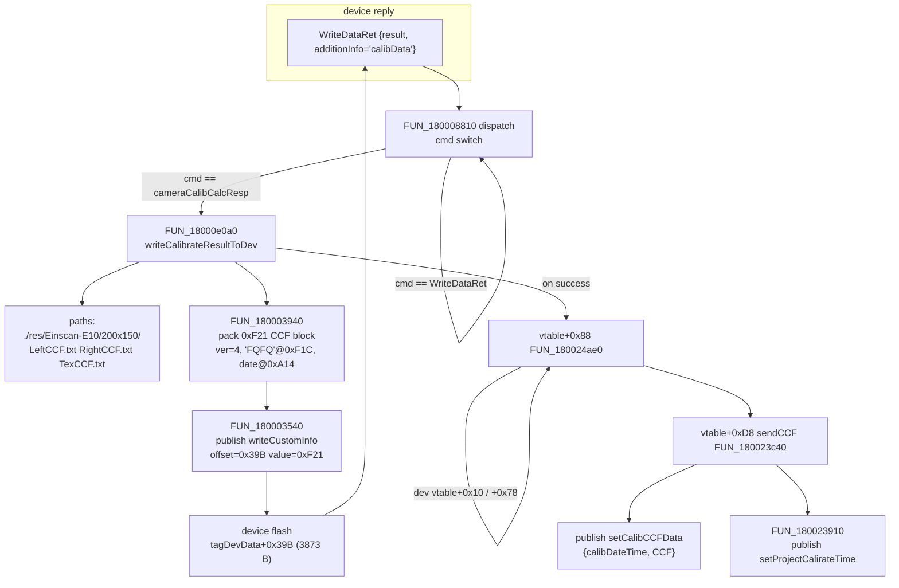

# EXStar 1.2.2.0 — Einstar calibration storage & write-back (RE report)

Target: SHINING 3D EXStar 1.2.2.0, modules `Sn3DCalibDevFile.dll`,
`Sn3DCalibrateData.dll`, `Sn3DEACalibrateController.dll`,
`Sn3DCalibrateAlgorithmWrapper.dll` (x86-64, image base `0x180000000`).
Method: offline read of the Ghidra 12.1.4 headless dumps in
`analysis/calibration/ghidra/dumps/` plus byte-level checks of the shipped
`.txt` CCF files, the vendor DLL bytes and the private device dump
`<device-dump.bin>`. No binary was executed, no
vendor file was modified.

Confidence labels used throughout: **A** = decompiled code *and* an
independent numeric/byte check agree; **B** = decompiled code only, one
interpretation step; **C** = inference (stated as such).

---

## 1. Module roles

| module | role | evidence |
|---|---|---|
| `Sn3DEACalibrateController.dll` | orchestrates calibration; packs the result into the device record and pushes it to flash; publishes the CCF | `Sn3DEACalibCompute.cpp` strings, `0x18000e0a0`, `0x180003940`, `0x180023c40` |
| `Sn3DCalibDevFile.dll` | device⇄file model: owns `tagDevData` (6568 B), extracts/creates the per-camera files under `…/200x150/` | `0x1800079b0`, `0x180007250`, `0x18000abc0` |
| `Sn3DCalibrateData.dll` | `Sn3DCalibData` QObject: reads/writes one CCF file, (de)serialises the 3-record set to `QVariant` | `0x18000aa00`, `0x18000c8e0`, `0x18000b8c0` |
| `Sn3DCalibrateAlgorithmWrapper.dll` | algorithm side: `Sn3D_double_CCF`, `CameraCalibParam::load_ccf_binary`, `Sn3D_write_encrpt_ccffile`, `CCFFileHelper`; builds `…/200x150/*` paths | strings `0x18007f670`, `0x18007e534`, `0x18005c000`; `0x18000eb50` |

---

## 2. Q1 — `Sn3DCalibDevFileController` device⇄file slots

### 2.1 `handleReadDevDataToFileCmd` `0x18000c3c0` (`Sn3DCalibDevFile.dump.txt:9549`)

It does **no I/O itself**; it drives `readDevCalDataToDisk` on the member
buffer `this+0x2e30` (a `tagDevData`) and stores the resulting timestamp:

```c
FUN_180008d20((longlong *)(this + 0x38),this + 0x2e30,local_88,local_80);   /* 0x18000c40c */
...
if (local_88[0] != '\0') { setCalibrateTime(this,local_80); }               /* 0x18000c480 */
```

* return `0` on success, `6` (`Sn3DErrorCode`) on failure; log tag
  `"[DP 2022 R]readDevCalDataToDisk OK."` / `"...Not readDevCalDataToDisk."`
  (`Sn3DCalibDevFileController.cpp:0x97/0xa0`). **A**
* `readDevDataToFileCmd` `0x18000d490` (`:10290`) is the public twin taking
  `(tagDevData&, QDateTime&)` — same call, returns `bool`. **A**
* The `tagDevData` bytes are supplied by the caller (controller layer); this
  module never issues the USB `ReadData`. **B**

### 2.2 `readDevCalDataToDisk` `0x180008d20` (`:7306`) — what actually happens

Order of operations (**A** for the call sequence, **B** for the semantics of
each helper):

1. `FUN_180008380` – pre-check of 6 configured paths (exists/size).
2. `FUN_1800086d0` – prepares 5 configured paths.
3. `FUN_1800079b0(this+8, tagDevData*, path@cfg+0x200)` — **keeps the 6568-byte
   blob verbatim**:
   `memcpy((void *)(param_1 + 0x1420),param_2,0x19a8);` (`:6473`).
   ⇒ `sizeof(tagDevData) == 0x19A8 == 6568`. This is the same size as the
   private device dump. **A**
4. `FUN_180006f20` → `FUN_180007250(this, Left, Right, Tex, &writeBox)` and
   `FUN_180007560(this, cfg+0xc0, cfg+0xe0)`; if `writeBox` it writes
   `200x150/activeBox.dat` = **6 little-endian doubles**, 48 bytes, written in the
   order `-1500, +1500, -1500, +1500, +200, +1500` (box x∈[−1500,1500],
   y∈[−1500,1500], z∈[200,1500]). (`:6019`)
5. `FUN_180009690` — reads the *colour* data ("`readDevColorDataToDisk`").
6. On success `FUN_180006930(this, QDateTime*)` returns the file time, which
   becomes the published calibration time.

### 2.3 CCF extraction `FUN_180007250` `0x180007250` (`:6131`)

```c
memcpy((void *)(param_1 + 0x455),(void *)(param_1 + 0x17bb),0xf21);        /* :6164 */
for (i=0;i<5;i++) if (*(char*)(param_1+0x1371+i) != (&DAT_1800120cc)[i]) goto fail;
if (*(int *)(param_1 + 0x455) == 4) {
    *param_5 = 1;                                                          /* write box */
    FUN_180007a80(param_1, LeftPath,  (char*)(param_1+0x561), *(int*)(param_1+0x55d));
    FUN_180007a80(param_1, RightPath, (char*)(param_1+0xa69), *(int*)(param_1+0xa65));
    FUN_180007a80(param_1, TexPath,   (char*)(param_1+0xf71), *(int*)(param_1+0xf6d));
}
```

The CCF sub-block is copied out of `tagDevData` at `+0x39B`
(`0x17bb-0x1420`), length `0xF21`, magic checked at block `+0xF1C`
(`0x1371 = 0x455+0xF1C`), version `int` at block `+0`. The write pointers are
`block+0x10C / +0x614 / +0xB1C` with lengths at `block+0x108 / +0x610 / +0xB18`
— exactly the layout measured in the device dump (§4). **A**
Failures log `"[DP 2022]writeCCFFile L/R/T Failed."` (`:0x16a/0x170/0x176`)
and leave `*param_5 = 0`. **A**

### 2.4 `handleEndCalibComputeCmd` `0x18000c020` (`:9378`) — compute vs read

It computes nothing. It reads `errorCode` out of the incoming
`QMap<QString,QVariant>` and, when `0`, calls
`handleNotifyIsCablliratedCmd(this)` and returns `1`; otherwise returns `0`.

```c
iVar1 = QVariant::toInt((QVariant *)this_00,(bool *)0x0);   /* key "errorCode" */
if (iVar1 == 0) { handleNotifyIsCablliratedCmd(this); return 1; }
```

**A** — "end of calibration compute" is a *notification*; the read/write work
happens in the two handlers above.

### 2.5 `handleNotifyIsCablliratedCmd` `0x18000c0a0` (`:9409`), `isCalibrated`, `notifyIsCalibrated`

Publishes one map: `{cmd:"notifyIsCalibrated", isCalibrated:<bool>}` where the
bool is `FUN_180008b60(this+0x38)` (`:7237`):

```c
bVar1 = FUN_180002d00(local_38);   /* cfg+0x1a0 = …/200x150/LeftCCF.txt  */
bVar2 = FUN_180002d00(local_58);   /* cfg+0x1c0 = …/200x150/RightCCF.txt */
bVar3 = FUN_180002d00(local_78);   /* cfg+0x1e0 = …/200x150/TexCCF.txt   */
return !bVar3 || (!bVar1 || !bVar2);
```

`FUN_180002d00` `0x180002d00` (`:2849`) opens the file, seeks to end and
returns **true when the file cannot be opened or has size 0**. Therefore the
published `isCalibrated` is true when **any** of the three files is missing or
empty, i.e. the value is inverted with respect to its name. **A** for the code,
**C** for intent (possible vendor bug, or the consumer negates it; no consumer
is present in the available dumps). `isFactoryCcf` `0x180022cf0` (`:29422`)
independently checks the same two IR files exist with size>0.

---

## 3. Q2 — `Sn3DCalibData` record layout (`Sn3DCalibrateData.dll`)

### 3.1 The file is binary, not text

`FUN_18000aa00` `0x18000aa00` (`:8604`) — one camera file:

```c
QDataStream::setByteOrder((QDataStream *)local_70,1);   /* 1 = LittleEndian  */
FUN_180003df0((QDataStream *)local_70,param_3);         /* 33 doubles        */
if (param_4 != (int *)0x0) { lVar5 = 0x40; do { QDataStream::operator>>(…,param_4); param_4++; }
                             while (lVar5-- != 0); }    /* 64 x int32        */
```

⇒ record = `33 × float64 LE` + optional `64 × int32 LE`. No text, no number
formatting, no header/CRC. **A**

`FUN_180003df0` `0x180003df0` (`:3824`) fixes the field order (file index →
in-memory offset; 11 doubles are read into a scratch and discarded):

| file idx | in-mem off | field | file idx | in-mem off | field |
|---|---|---|---|---|---|
| 0 | +0x08 | fx | 20 | +0xA0 | Tx |
| 1 | +0x10 | fy | 21 | +0xA8 | Ty |
| 2,3 | — | pad 0.0 | 22 | +0xB0 | Tz |
| 4 | +0x18 | cx | 23 | +0x58 | R[0] |
| 5 | +0x20 | cy | 24 | +0x60 | R[1] |
| 6,7 | — | pad | 25 | +0x68 | R[2] |
| 8 | +0x50 | alpha | 26 | +0x70 | R[3] |
| 9 | — | pad | 27 | +0x78 | R[4] |
| 10 | +0x28 | k1 | 28 | +0x80 | R[5] |
| 11 | +0x30 | k2 | 29 | +0x88 | R[6] |
| 12 | +0x38 | p1 | 30 | +0x90 | R[7] |
| 13 | +0x40 | p2 | 31 | +0x98 | R[8] |
| 14 | +0x48 | k3 | 32 | — | error (discarded) |
| 15–19 | — | pad | | | |

In-memory record = `0xB8` (184 B): 8-byte header at `+0x00` (never filled from
file) + **22 doubles** in the order `f, c, kc[5], alpha, R[9], T[3]`. **A**
(verified: re-emitting the 22 doubles + pads + trailer reproduces
`LeftCCF.txt`/`RightCCF.txt` byte-for-byte, see §6.3).

### 3.2 Sizes and paths

* `TexCCF.txt` = 264 B (33 f64, colour, **no trailer**);
  `LeftCCF.txt` / `RightCCF.txt` = 520 B (264 + 256 B trailer). **A**
* Path strings: `Sn3DCalibrateData.dump.txt` `0x180014870..0x180014898` —
  `"/200x150/LeftCCF.txt"`, `"/200x150/RightCCF.txt"`, `"/200x150/TexCCF.txt"`;
  QVariant keys `leftCCF`, `rightCCF`, `texCCF` (`:0x1800148b0..`). **A**
* The container is a `std::vector<record>` at `this+0x20` with stride `0xB8`
  (`serializeCCF` computes `(end-begin)/0xB8`; needs ≥2 records for L/R and a
  3rd for Tex). **A**

### 3.3 `readCCF` / `writeCCFToFile` / `serializeCCF` / `deserializeCCF`

| function | addr (dump line) | behaviour |
|---|---|---|
| `readCCF()` | `0x18000ac20` (`:8711`) | clears the vector, `FUN_18000a840(this+0x88, paths, &vec)`, then writes `ConfigInfo+0x10/+0x14` into every record's `+0x00/+0x04` (a per-camera id/dark pair). **B** |
| `readCCF(tagQuickCCFData&)` | `0x18000ac00` (`:8694`) | thin wrapper → `FUN_180009de0`; parses the **device** block (magic at `+0xF1C`, version==4). **A** |
| `writeCCFToFile(std::string,char*,int)` | `0x18000c8e0` (`:10071`) | `FUN_18000c650(this+0x88, path, buf, len)` = `fstream(path,"wb")` + `write(buf,len)`; fails silently if `len-1 >= 0x400` (≤1024 B). **A** |
| `serializeCCF()` | `0x18000b8c0` (`:9320`) | builds `QMap{"leftCCF":QVariant(record0,destructor), "rightCCF":…, "texCCF":…}` — raw `0xB8` records, not files. **A** |
| `deserializeCCF(QVariant)` | `0x180005eb0` (`:5485`) | reverse: takes `leftCCF`/`rightCCF`, takes `texCCF` only if the count allows 3; `FUN_180009920` appends. **A** |
| per-file loop | `0x18000a840` (`:8541`) | takes up to 3 paths from a `std::vector<QString>`, calls `FUN_18000aa00(path,&rec,&keys)`, then `FUN_180005ca0(this,&rec)` (key removal) and `FUN_180005ca0` on the 3rd. **A** |

### 3.4 The 256-byte trailer and the "key" — what the code proves

`FUN_180005ca0` `0x180005ca0` (`:5453`) applies 22 per-field **integer**
offsets read from two 64-int tables inside the `Sn3DCalibData` object
(`+0x08` and `+0x108`, filled from the trailer/device block):

```c
*(double *)(param_2 + 0x50) = *(double *)(param_2 + 0x50) - (double)*(int *)(param_1 + 0x18); /* alpha  <- key[4] */
*(double *)(param_2 + 0x28) = *(double *)(param_2 + 0x28) - (double)*(int *)(param_1 + 0x1c); /* k1     <- key[5] */
*(double *)(param_2 + 0x30) = (double)*(int *)(param_1 + 0x20) + *(double *)(param_2 + 0x30); /* k2     <- key[6] */
```

Measured (A): the de-keyed device blocks equal the shipped CCF coefficients
**bit-exactly** after subtracting the fixed integers

| field | IR offset | colour offset |
|---|---|---|
| alpha | +2 | 0 |
| k2 | +6 | 0 |
| p1 | +2 | 0 |
| p2 | +7 | 0 |
| k3 | +13 | 0 |
| k1, fx, fy, cx, cy, T, R | 0 | 0 |

(Left `k2` 6.173297958 → 0.173297958; `p1` 2.000186725 → 0.000186725;
`p2` 7.000146796 → 0.000146796; `k3` 13.018457014 → 0.018457014; Tex all five
already unshifted.)

**Unresolved:** the stored 256-byte trailer of these files is `64 × int32` with
values `0..9` only (Left starts `1,4,9,8,2,5,1,1,5,7,…`) and is **bit-identical
across two different calibrations** — so it does not literally contain
`{2,6,2,7,13}`. Either the trailer seeds the key through code not present in
these dumps, or the keys are hard-coded and the trailer is unrelated
(a per-camera constant table). The keying is therefore *integer offsetting of
the small coefficients* (they stop looking like distortion terms), not
cryptography — no cipher, no secret, reversible with the offsets above. **C**
for the trailer's role; **A** for the offsets.

---

## 4. Q3 — controller write-back

### 4.1 Call graph (mermaid)



### 4.2 The packer `FUN_180003940` `0x180003940` (`Sn3DEACalibrateController.dump.txt:5785`)

```c
memset(param_1,0,0xf21);
iVar2 = FUN_180002c00(param_1, plVar3, (char *)(param_1 + 0x43));  param_1[0x42] = iVar2;   /* Left  ->+0x10C, len@+0x108 */
iVar2 = FUN_180002c00(param_1, plVar3, (char *)(param_1 + 0x185)); param_1[0x184] = iVar2;  /* Right ->+0x614, len@+0x610 */
iVar2 = FUN_180002c00(param_1, plVar3, (char *)(param_1 + 0x2c7)); param_1[0x2c6] = iVar2;  /* Tex   ->+0xB1C, len@+0xB18 */
param_1[0x3c7] = 0x51465146;  *(undefined1 *)(param_1 + 0x3c8) = 0;   /* "FQFQ\0" at +0xF1C */
*param_1 = 4;                                                        /* version           */
uVar5 = FUN_180003540((longlong)param_1,0x39b,local_b8);             /* place at +0x39B   */
```

plus a `QDateTime::toString("yyyy-MM-dd hh:mm")` copied to block `+0xA14`
(`:5859`). **A**

### 4.3 The device write `FUN_180003540` `0x180003540` (`:5637`)

```c
QVariant::QVariant(local_c8,"writeCustomInfo");
local_160 = QString::fromAscii_helper("offset",6);   /* QVariant(0x39B)        */
local_158 = QString::fromAscii_helper("value",5);    /* QVariant(QByteArray)   */
QVariant::QVariant(local_98,"calibData");            /* key "additionInfo"     */
QMetaObject::invokeMethod(*(undefined8 *)(param_1 + 0xf28),"publish",2, …);
```

⇒ the write is a **publish** to the device object: `offset=0x39B`,
`value=0xF21-byte CCF block`, `additionInfo="calibData"`; the device answers
with `WriteDataRet` carrying the same `additionInfo` and an integer `result`.
**A** (the actual USB `WriteData` lives in the device module, which is not in
these dumps — **C** for the transport framing).

### 4.4 `sendCCF` `0x180023c40` (`:29976`)

```c
QVariant::QVariant(local_130,"setCalibCCFData");
… (**(code **)(*plVar4 + 0x68))(plVar4,&local_1e0,0,uVar8) …  /* calibDateTime */
cVar6 = (**(code **)(**(longlong **)(param_1 + 0x38) + 0x80))();
if (cVar6 == '\0') { errorCode = 0x2000002; } else { errorCode = 0; map["CCF"] = <serializeCCF>; }
… FUN_180023910(param_1);   /* publish {cmd:"setProjectCalirateTime", calibrateTime} */
```

Linked into the write path by vtable slot **+0xD8** of
`Sn3DEACalibrateDataController` (`vtable @0x180032840`, entry
`0x180032918`), reached from slot **+0x88** `FUN_180024ae0`:

```c
cVar1 = (**(code **)(*(longlong *)param_1[7] + 0x10))();
(**(code **)(*(longlong *)param_1[7] + 0x78))((longlong *)param_1[7],cVar1 != '\0');
(**(code **)(*param_1 + 0xd8))(param_1);
```

and `FUN_18000e0a0` calls it through `Sn3DEACalibrateDataController` after the
pack succeeded: `(**(code **)(*plVar10 + 0x88))(plVar10);`. **A**

### 4.5 Answers

* **Does calibration overwrite the factory CCF files, write the blob, or both?**
  **Both.** (a) `writeCalibrateResultToDev` re-reads
  `./res/Einscan-E10/200x150/{Left,Right,Tex}CCF.txt` and packs them; the same
  three files are what the calibration run itself rewrites (the algorithm
  wrapper writes `/200x150/LeftCCF.txt` etc., `FUN_18000eb50` in
  `Sn3DCalibrateAlgorithmWrapper` after `Sn3D_double_CCF`). The base is
  `"./res/" + "Einscan-E10"` — the 6-byte literal `2e 2f 72 65 73 2f`
  (`"./res/"`) sits at `0x18002fd38` in `.rdata`, verified in the DLL bytes.
  **A**
  (b) the packed `0xF21` block is written to the device at absolute offset
  `0x39B` of the 6568-byte record, then `setCalibCCFData` +
  `setProjectCalirateTime` are published. **A**
* **What is `cameraCalibFlag.dat`?** `FUN_18000df30` `0x18000df30` (`:14057`)
  writes `<dir>/200x150/cameraCalibFlag.dat` with `QFile::open(…,10)`
  (WriteOnly|Truncate) and `QDataStream::setByteOrder(…,1)` followed by
  `operator<<(stream, QDateTime::currentDateTime())` — i.e. a little-endian
  Qt-serialised **timestamp of the last camera calibration**, ~13 bytes
  (qint64 msecs + time-spec, Qt5 layout; exact width **C**). Failure logs
  `"write cameraCalibFlag file failed."` No reader exists in the available
  dumps. **A** for writer/format, **C** for purpose.
* **Is there a backup?** No CCF backup. The string table has a `backup/`
  path (`getConfigInfo`, `0x1800128d8`-adjacent, `:9301` of
  `Sn3DCalibDevFile.dump.txt`) and a `DeviceCCF/` path (`:9253`), but the
  shipped `backup/Einscan-E10/200x150/` contains only `ParaCCM_*`/`ParaDark_*`
  (12 files, no CCF), and the vendor tree ships `res/Einscan-E10/` **without**
  any `200x150/LeftCCF.txt`. There is no copy-before-overwrite in the write
  path (`FUN_180003940` only reads). **A** (absence), **B** (`backup/` is used
  only for ini/Para* data).
* **What happens on failure?**
  1. pack/read failure (`FUN_180003940` returns 0) → `FUN_180009dc0(msg,7,0x19,1)`
     (error 0x19), `writeCalibrateResultToDev` returns 0, no device write.
  2. device `WriteDataRet` with `result != 0` → error `0x19` when
     `calibType==4`, `0x1f` when `calibType==2`; the controller clears
     `param_1[0x38]`, calls `FUN_18000adb0(param_1,true)` (error state) and
     publishes `FUN_18000b620(param_1,false,msg)`. (`:10597`, branch at
     `WriteDataRet`/`"WriteDataRet calibration."`)
  3. `setCalibCCFData` false → `errorCode = 0x2000002` in the published map.
  In all failure cases the three files already on disk stay as the algorithm
  left them and the device keeps its previous `0xF21` block — the two media are
  **not** rolled back together. **B**

---

## 5. Q4 — what the procedure actually updates, and how it is applied

**Does it update factory calibration, create a user correction, or generate new
parameters?** It **regenerates a complete 3-camera CCF set and overwrites the
factory files in place**, then mirrors that set into the device record. There is
no separate "user correction" file and no merge step in the writer: the packer
copies the three files verbatim (§4.2).

**But the numbers show a partial re-estimation, not a full one** (**A**, measured
between the device's 22-double camera blocks and the shipped CCFs):

| field | Left | Right | Tex |
|---|---|---|---|
| fx, fy | 1167.12/1155.02 → 1158.76/1158.68 | 1166.09/1153.72 → 1157.27/1157.10 | 1141.08/1141.09 → 1140.35/1140.29 |
| cx, cy | 617.91/533.56 → 624.19/534.60 | 629.50/493.51 → 635.78/490.31 | 633.10/521.12 → 633.63/520.09 |
| k1, k2, p1, p2, k3 | **bit-identical** (after de-key) | **bit-identical** | **bit-identical** |
| alpha | 6.2e-5 → 9.8e-5 | 1.8e-4 → 2.1e-4 | −9.5e-5 → 9.8e-5 |
| T (mm) | 48.20,−37.73,273.15 → −23.78,−21.12,553.67 | −7.82,−37.60,266.00 → 29.04,−20.40,552.59 | 3.04,−20.92,264.20 → 16.90,−21.60,548.90 |

⇒ the distortion model (5 coefficients) is **carried over bit-exactly from the
factory CCF**; focal length, principal point, alpha and the pose are
re-estimated. The pose change is large (Tz 273 → 554 mm) and all three cameras
end up near a common, almost-diagonal R with |Tz|≈550 mm — i.e. the stored
pose is in a *different frame* than the shipped CCF's T. Whether that frame is
"rectified stereo" or a rig frame is **not proven** here (**C**; open question
O4).

**Do all 3 records get replaced?** Yes — three files, three lengths, three
records, and the colour record is rewritten too (its fx/cx change as well).
Only the kc block is provably preserved. **A** for "all three written",
**B** for "kc preserved by design" (it could also be that the plate
optimisation simply never touches kc). Inference direction: the two sets share
kc bit-for-bit, so they are the same calibration lineage; which of the two was
written first is **not** proved by the bytes alone (the CCF block carries
`2026-02-09 21:34` at `+0xA14`, the device identity strings date from
`<redacted-production-date>`).

**How EXStar applies the CCF at scan time** (**B**): the algorithm wrapper
builds `param_6 + "/200x150/LeftCCF.txt"`, `…/RightCCF.txt` (`FUN_18000eb50`,
dump lines 18158/18168), plus `/200x150/TexCCF.txt`, `activeBox.dat`,
`lookupTable.dat` (`:19506-19652`), and loads them through
`Sn3DAlgorithm::CameraCalibParam::load_ccf_binary(std::string)`; two CCF
variants exist (`Sn3D_write_bina_ccffile`, `Sn3D_write_encrpt_ccffile`) and the
failure path logs `"[DP 2022]Not Find CCF."`. `initRebuildParam` also accepts a
`devData` payload (`initRebuildParam devData.`), i.e. the device record can be
used instead of the files. **C**: the exact precedence (files vs `devData`) is
not resolved by the available dumps.

---

## 6. Q5 — exact on-disk format, and a freshly written candidate

### 6.1 Format (per camera, little-endian, no text at all)

| offset | size | type | content |
|---|---|---|---|
| 0x000 | 8 | f64 | fx |
| 0x008 | 8 | f64 | fy |
| 0x010 | 16 | 2×f64 | 0.0 pad |
| 0x020 | 8 | f64 | cx |
| 0x028 | 8 | f64 | cy |
| 0x030 | 16 | 2×f64 | 0.0 pad |
| 0x040 | 8 | f64 | alpha |
| 0x048 | 8 | f64 | 0.0 pad |
| 0x050 | 40 | 5×f64 | k1,k2,p1,p2,k3 |
| 0x078 | 40 | 5×f64 | 0.0 pad |
| 0x0A0 | 24 | 3×f64 | Tx,Ty,Tz (mm) |
| 0x0B8 | 72 | 9×f64 | R row-major, world→camera |
| 0x100 | 8 | f64 | reprojection error (read then discarded) |
| 0x108 | 256 | 64×i32 | trailer, IR files only, values 0..9 |

`TexCCF.txt` ends at 0x108. No magic, no version, no length, no CRC — the only
self-description is the file size (264 vs 520). **A**

### 6.2 Device record `tagDevData` (6568 B) and the embedded CCF block

| blob offset | size | content | evidence |
|---|---|---|---|
| 0x000 | 12 | `i32 1`, `i32 1280`, `i32 1024` (version, width, height) | dump bytes |
| 0x00C | 176 | camera[0] 22×f64 (`f,c,kc,alpha,R,T`) | matches CCF after de-key |
| 0x0BC | 72 | zero (reserved; 9×f64 = possible CCM slot, unproven) | bytes |
| 0x104 | 176 | camera[1] | idem |
| 0x1B4 | 72 | zero | |
| 0x1FC | 176 | camera[2] | idem |
| 0x2AC | 72 | zero | |
| 0x2F4 | ≈167 | tagged f32 tables `"FAFA"+0x200`, `"FBFB"+0x300`, 15 floats each | bytes |
| **0x39B** | **0xF21 (3873)** | **CCF block** (below) | `FUN_180007250`, `FUN_180003940` |
| 0x12BC | 4 | `i32 5` | bytes |
| 0x12C0 | 72 | wbdata (18×f32), **byte-identical to shipped `wbdata.txt`** | bytes |
| 0x168B | 20 | `"<redacted-serial>"` (device id) | bytes |
| 0x178F | 21 | `"<redacted-part-number>"` (board id) | bytes |
| 0x1893 | 10 | `"<redacted-production-date>"` (manufacture date) | bytes |
| 0x19A8 | — | end (= sizeof(tagDevData), `memcpy(...,0x19a8)`) | `0x1800079b0` |

CCF block (absolute `0x39B`):

| +offset | size | content |
|---|---|---|
| 0x000 | 4 | version = `4` |
| 0x108 | 4 | length Left = 520 |
| 0x10C | 520 | `LeftCCF.txt` bytes |
| 0x610 | 4 | length Right = 520 |
| 0x614 | 520 | `RightCCF.txt` bytes |
| 0xA14 | ≤17 | `"yyyy-MM-dd hh:mm"` ASCII timestamp |
| 0xB18 | 4 | length Tex = 264 |
| 0xB1C | 264 | `TexCCF.txt` bytes |
| 0xF1C | 5 | magic `46 51 46 51 00` (`"FQFQ\0"`) |
| 0xF21 | — | end of block |

Slot stride between payloads is `0x508` (1288 B); only `0x208`/`0x108` are used,
the rest is zero padding. **A**

Cross-check: `<device-dump.bin>` contains the shipped
`res_Einscan-E10_200x150` files byte-for-byte at `0x4A7`, `0x9AF`, `0xEB7`
(= `0x39B + 0x10C/0x614/0xB1C`), with `520/520/264` at `0x4A3/0x9AB/0xEB3` and
the block timestamp `"2026-02-09 21:34"` at `0xDAF` (= `0x39B + 0xA14`). **A**

### 6.3 Freshly written candidate vs shipped CCF

`analysis/calibration/re/candidate_{Left,Right,Tex}CCF.txt` were produced by
implementing `FUN_180003df0` (read 33 doubles → 22-field record) and its inverse
(22 fields → 33 doubles, pads zero) plus the original 256-byte trailer:

| file | result |
|---|---|
| `LeftCCF.txt` | **byte-identical** (520 B) |
| `RightCCF.txt` | **byte-identical** (520 B) |
| `TexCCF.txt` | differs at **byte 256 only** = double #32, the reprojection error (0.076458 → 0.0) |

⇒ the writer is fully recovered except that the in-memory record has **no slot
for `error`**: the vendor's own read path discards file double #32, so any
write-back that round-trips through the 22-double record silently zeroes it.
For a lossless host tool, keep the raw file bytes (or at least double #32).
**A**

---

## 7. Function address table

| addr | dump:line | purpose | quoted pseudocode (1–3 lines) |
|---|---|---|---|
| `0x18000c3c0` | DevFile:9549 | `handleReadDevDataToFileCmd` | `FUN_180008d20((longlong *)(this + 0x38),this + 0x2e30,local_88,local_80);` … `if (local_88[0] != '\0') { setCalibrateTime(this,local_80); }` |
| `0x18000d490` | DevFile:10290 | `readDevDataToFileCmd(tagDevData&,QDateTime&)` | same call, returns `bVar1` |
| `0x180008d20` | DevFile:7306 | `readDevCalDataToDisk` | `FUN_1800079b0(local_3b8,param_2,plVar7);` … `uVar13 = FUN_180006f20(plVar7,…5 paths…,&local_3f8,local_3f7);` |
| `0x1800079b0` | DevFile:6455 | store raw blob + path | `memcpy((void *)(param_1 + 0x1420),param_2,0x19a8);` |
| `0x180007250` | DevFile:6131 | extract 3 CCF files | `memcpy((void *)(param_1 + 0x455),(void *)(param_1 + 0x17bb),0xf21);` … `if (*(int *)(param_1 + 0x455) == 4) {` |
| `0x180007a80` | DevFile:6500 | one CCF file write | `FUN_180007a80(param_1,path,(char*)(param_1+0x561),*(int*)(param_1+0x55d));` |
| `0x180002c00` | EACtl:— | read whole file, cap 1024 B | `p_Var2 = std::_Fiopen((char *)plVar7,0x21,0x40);` … `iVar9 = piVar5[2] + *piVar5; if (iVar9 < 0x401) { … return iVar9; }` |
| `0x180006f20` | DevFile:6019 | write CCF set + box | `uVar4 = FUN_180007250(param_1,plVar3,plVar2,plVar1,param_7);` |
| `0x18000abc0` | DevFile:8664 | `getConfigInfo` path table | `"200x150/LeftCCF.txt"`, `"DeviceCCF/"`, `"backup/"`, `"200x150/activeBox.dat"`, `"200x150/lookupTable.dat"` |
| `0x180008b60` | DevFile:7237 | `isCalibrated` (inverted) | `return !bVar3 \|\| (!bVar1 \|\| !bVar2);` |
| `0x180002d00` | DevFile:2849 | file missing/empty | `bVar5 = lVar1 + lVar2 == 0;` (after `tellg`) |
| `0x18000c0a0` | DevFile:9409 | notify handler | `QVariant::QVariant(local_a8,"notifyIsCalibrated");` … `QVariant::QVariant(local_98,bVar6);` key `"isCalibrated"` |
| `0x18000c020` | DevFile:9378 | end-of-compute slot | `if (iVar1 == 0) { handleNotifyIsCablliratedCmd(this); return 1; }` |
| `0x18000aa00` | CalibData:8604 | read one CCF file | `QDataStream::setByteOrder(…,1); FUN_180003df0(…,param_3); … 0x40 × operator>>` |
| `0x180003df0` | CalibData:3824 | 33 doubles → record | `operator>>(param_1,(double *)(param_2 + 0x50));` (alpha) … `(double *)(param_2 + 0x58)` (R) |
| `0x180005ca0` | CalibData:5453 | apply key offsets | `*(double *)(param_2 + 0x50) = *(double *)(param_2 + 0x50) - (double)*(int *)(param_1 + 0x18);` |
| `0x18000a840` | CalibData:8541 | read 1–3 files | `uVar3 = FUN_18000aa00(param_1,pQVar2,(longlong)local_278,(int *)(param_1 + 8));` |
| `0x180009de0` | CalibData:8167 | parse device CCF block | `*(char *)((longlong)param_2 + lVar3 + 0xf1c) != (&DAT_1800146e8)[lVar3]` … `if (*param_2 == 4)` |
| `0x18000c8e0` | CalibData:10071 | `writeCCFToFile` | `uVar3 = FUN_18000c650(this + 0x88,plVar2,param_3,param_4);` |
| `0x18000b8c0` | CalibData:9320 | `serializeCCF` | `QString::QString(local_res8,"leftCCF");` … `QString::QString(local_res20,"texCCF");` |
| `0x180005eb0` | CalibData:5485 | `deserializeCCF` | `QVariant::toMap(param_2); QString::QString(local_res20,"leftCCF");` |
| `0x180023c40` | EACtl:29976 | `sendCCF` | `QVariant::QVariant(local_130,"setCalibCCFData");` … `cVar6 = (**(code **)(**(longlong **)(param_1 + 0x38) + 0x80))();` |
| `0x18000e0a0` | EACtl:14119 | `writeCalibrateResultToDev` | `uVar12 = FUN_180003940(local_f68,plVar11,plVar10,(longlong *)&local_1028);` … `(**(code **)(*plVar10 + 0x88))(plVar10);` |
| `0x180003940` | EACtl:5785 | pack `0xF21` block | `memset(param_1,0,0xf21);` … `param_1[0x3c7] = 0x51465146; *param_1 = 4;` |
| `0x180003540` | EACtl:5637 | publish `writeCustomInfo` | `QVariant::QVariant(local_c8,"writeCustomInfo");` … `QVariant::QVariant(local_98,"calibData");` |
| `0x180024ae0` | EACtl:— | `vtable+0x88` | `(**(code **)(*param_1 + 0xd8))(param_1);` |
| `0x180023910` | EACtl:29839 | publish calib time | `QVariant::QVariant(local_a0,"setProjectCalirateTime");` |
| `0x18000df30` | EACtl:14057 | write `cameraCalibFlag.dat` | `QDataStream::setByteOrder(local_88,1); operator<<(local_88,local_b0);` |
| `0x180008810` | EACtl:10597 | cmd dispatch | `QString::compare_helper(…,"cameraCalibCalcResp",-1,1)` … `"WriteDataRet"` … `"whiteBalanceCalcResp"` |
| `0x180022cf0` | EACtl:29422 | factory-CCF presence | `bVar1 = QFileInfo::exists(local_res18);` … `return 0 < _Var7 && ((bVar1 && bVar2) && 0 < _Var6);` |

`readDevDataToFileCmd`'s dump-line anchor for `0x180007a80` is inside
`FUN_180007250`; `0x180024ae0` has no string anchor and was identified by
vtable (`0x180032840 + 0x88`, DLL file offset `0x318C8`).

---

## 8. Q6 — reversible host-side profile (proposal)

Design goal: never lose the factory numbers, make every write replayable, and
keep device and files consistent.

```
~/.local/share/einstar-profiler/
  factory/<serial>/                       # immutable, created once, chmod 0444
      device-<date>-<sha8>.bin            # raw 6568-byte tagDevData, verbatim
      ccf/LeftCCF.txt RightCCF.txt TexCCF.txt   # extracted from device+0x39B
      ccf.sha256                          # per-file + block hashes
      meta.json                           # serial, fw, capture time, source
  profiles/<id>/
      rev-0000/  ccf/{Left,Right,Tex}CCF.txt   # full copy, never a diff
                 block-0xF21.bin               # assembled device block
                 tagdev-overlay.bin            # 3873 B at 0x39B, for patching
                 cameraCalibFlag.dat           # QDateTime, LE
                 meta.json                     # parent, rev, calibType, ts
  current -> profiles/<id>/rev-0000
```

Rules (each maps to a fact above):

1. **Capture before calibrating.** Read the whole 6568-byte record and store it
   verbatim (§2.2 `0x19A8`), plus the three decoded files. The vendor has no CCF
   backup (§4.5), so this is the only copy.
2. **Never write into the vendor install tree.** The vendor writes
   `./res/Einscan-E10/200x150/…` in place; a reimplementation should own its own
   root and only *materialise* that path when a vendor-compatible run is needed.
3. **Store full files, not diffs.** A profile is a 3-file set of exactly
   520/520/264 bytes. Diffs are unsafe because re-serialising through the
   22-double record drops double #32 (`error`, §6.3) and the 256-byte IR trailer
   is per-camera constant — copying raw bytes preserves both.
4. **Keep the assembled block, not just the files.** Record
   `block-0xF21.bin` (version 4, lengths at 0x108/0x610/0xB18, date at 0xA14,
   `FQFQ` at 0xF1C) so a device write can be replayed without re-implementing
   the packer.
5. **Versioning.** Monotonic `rev-NNNN` with `parent` hash and a sha256 over
   `{3 files, block}`. Timestamps: keep both the file mtime, the in-band
   `yyyy-MM-dd hh:mm` at block `0xA14`, and `cameraCalibFlag.dat`.
6. **Write-back ordering** (mirrors `§4.1`):
   1. persist new profile + `fsync`, update `current`;
   2. verify the 3 files are 520/520/264 and the block magic/version;
   3. publish `writeCustomInfo{offset:0x39B, value:block, additionInfo:"calibData"}`
      and wait for `WriteDataRet{additionInfo:"calibData", result==0}`;
   4. `setCalibCCFData{calibDateTime, CCF}`; on `errorCode != 0` abort;
   5. `setProjectCalirateTime`;
   6. only then write `cameraCalibFlag.dat`.
7. **Read-back verification.** Re-read 6568 bytes, compare `[0x39B,0x12BC)`
   byte-for-byte with `block-0xF21.bin`; mismatch ⇒ mark profile `unverified`,
   restore the factory block from `factory/`.
8. **Failure policy.** Steps 3–5 are not atomic in the vendor design (files and
   device can diverge, §4.5). On any failure keep the previous `current`, do not
   touch `cameraCalibFlag.dat`, and present both media states to the user.
9. **Interop.** For reading vendor installs, accept `./res/Einscan-E10/200x150/`
   and the `_noled` / `_portrait` ParaCCM/ParaDark/wbdata variants; treat the
   5 kc coefficients as factory-owned (re-estimate only f, c, alpha, pose unless
   the user asks otherwise).

---

## 9. Unresolved questions

* **O1** The 256-byte trailer does not contain the measured integer offsets
  `{alpha +2, k2 +6, p1 +2, p2 +7, k3 +13}`; its role (key seed vs unrelated
  per-camera constant) is not proven. It is bit-identical across two
  calibrations, so it is not data-derived.
* **O2** No reader for `cameraCalibFlag.dat` in the available dumps; its
  consumer and the exact serialised length (Qt5 `QDateTime`) are unverified.
* **O3** The actual USB `WriteData`/`ReadData` framing for offset `0x39B` and
  size `0x19A8` lives in the device module (not dumped). The offset/size are
  proven host-side only.
* **O4** The frame of the pose in the device's 22-double blocks (Tz≈554 mm vs
  the CCF's 273 mm) is unexplained — rectified stereo vs rig frame.
* **O5** Whether the algorithm wrapper prefers the on-disk files or the
  `devData` payload when both exist (`initRebuildParam devData.`).
* **O6** `isCalibrated` is published inverted; whether a consumer negates it
  could not be checked.

---

## 10. Reproduction

```bash
# byte layout of the device record (offsets 0x39B, 0x10C/0x614/0xB1C, 0xF1C)
python3 - <<'PY'
b=open('<device-dump.bin>','rb').read()
assert len(b)==0x19A8
print(b[0x39B:0x39F].hex(), b[0x12B7:0x12BC], b[0xDAF:0xDBF])
PY
# writer round-trip (Left/Right identical, Tex error field dropped)
python3 analysis/calibration/re/scratch/ccf_roundtrip.py
```
