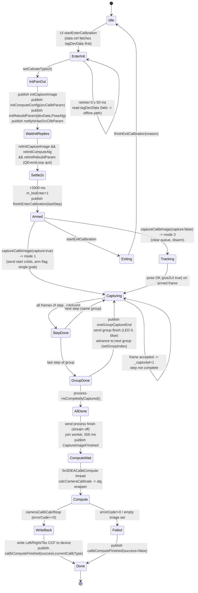

# Einstar (EXStar 1.2.2.0 / Einscan-EA) — scanner–calibration workflow, recovered state machine

Offline, read-only RE of the Ghidra 12.1.4 headless dumps. No binary was executed, no vendor file modified.
Every claim is tagged **[A]** code-proven, **[B]** strong inference (code + data, call site indirect), **[C]** hypothesis.
Addresses are RVA-style image addresses as printed by Ghidra (`0x1800xxxxx`), never invented.

Evidence aliases used below:

| alias | file |
|---|---|
| CTRL | `analysis/calibration/ghidra/dumps/Sn3DEACalibrateController.dump.txt` |
| CAP  | `analysis/calibration/ghidra/dumps/Sn3DCalibCaptureImageProcess.dump.txt` |
| LOAD | `analysis/calibration/ghidra/dumps/Sn3DCalibrateLoader.dump.txt` |
| ALG  | `analysis/calibration/ghidra/dumps/Sn3DCalibrateAlgorithmWrapper.dump.txt` |
| XML  | `sources/vendor/EXStar_1.2.2.0/res/calibrateConfig/Einscan-EA/rapidCameraCalibrate.xml` |
| MAN  | `/tmp/manual/en.txt` (pdftotext of the official manual, calibration chapter) |
| INI  | `sources/vendor/EXStar_1.2.2.0/res/Einscan-E10/ini/*.ini` |

Companion machine-readable file: `analysis/calibration/re/workflow_summary.json`.

---

## 0. Component map (who owns which state)

| module | class / object | role | evidence |
|---|---|---|---|
| `Sn3DEACalibrateController.dll` | `Sn3DEACalibrateController` | entry/exit orchestration, init fan-out, device command emitters, `finishEnterCalibration`, `oneGroupCaptureEnd`, CCF write-back | CTRL:17118 (`dispatchCmd`), CTRL:18120, CTRL:19455, CTRL:21655 |
| same DLL | `Sn3DEACalibCompute` | compute-side command handler (`initComputeConfig`, `setCalibType`, `CaptureImageFinished`, `WriteDataRet`, `cameraCalibCalcResp`, `whiteBalanceCalcResp`), worker thread for the actual solve | CTRL:10597, CTRL:11828, CTRL:11881 |
| same DLL | `Sn3DEACalibrateDataController` | device blob (`tagDevData`, 0x19a8 B) fetch/persist, `startEnterCalibration` forward, CCF/CCMDark/WB file I/O, `notifyIsCalibrated`, `setCalibCCFData` | CTRL:28439, CTRL:29100, CTRL:29976 |
| `Sn3DCalibrateLoader.dll` | `CaptureProcess` / `GroupNode` / `StepNode` / `ImgCaptureInfo` | XML model, per-step pose windows, `_captured` flags, `isCompletelyCaptured` virtuals | LOAD:7916, LOAD:9190, LOAD:13185 |
| `Sn3DCalibCaptureImageProcess.dll` | `CalibCaptureImageProcess(Private)` | runtime capture state machine, pose gating, UI info, height-OK events, image queue drain | CAP:12948, CAP:17968, CAP:18786, CAP:21333 |
| same DLL | `EACalibCaptureImageController(Private)` | Einstar/E10 device-specific capture: mode machine, exposure/indication, per-frame grab | CAP:40438, CAP:42662, CAP:43285, CAP:44506 |
| `Sn3DCalibrateAlgorithmWrapper.dll` | `CameraCalibrateAlgManager`, `runRapidCameraCalibratePose` | pose estimation (`poseAlgMethod` in XML) and the CCF solve | ALG strings `runRapidCameraCalibratePose`, `cameraCalibCalcResp` |

Data flow is a publish/subscribe bus: every component emits `QVariantMap {cmd: "...", ...}` (`QMetaObject::invokeMethod(obj,"publish",...)`, e.g. CTRL:19455 tail) and the receivers dispatch on `cmd` (`QString::compare_helper(...,"<name>",-1,1)`).

---

## 1. State machine



### 1.1 Command → handler table

| state / command (`cmd` string) | handler (address, dump line) | actions | next state |
|---|---|---|---|
| `startEnterCalibration` (UI → data ctrl) | `Sn3DEACalibrateDataController::onSubscribeData` CTRL:28439; vtable `+0xa8` forward | if not already read: `Sn3DCalibDevFileController::readDevDataToFileCmd(tagDevData, QDateTime)` (CTRL:28645), then forward to controller | controller `dispatchCmd` |
| `startEnterCalibration` (ctrl) | `Sn3DEACalibrateController::dispatchCmd` CTRL:17118, branch at CTRL:17266 → `handleEnterClibrateCmd` **FUN_180013040** CTRL:18120 | see §1.2 | `EnterInit` |
| `initCalibrate` | branch CTRL:17260 → `FUN_180013800` (sets a bool param) + `FUN_180016260` | mode/flag reset | stays EnterInit |
| `retInitCaptureImage` | branch CTRL:17235 → `FUN_180001500` (sets quit flag) | releases init wait | `WaitInitReplies` |
| `retInitRebuildParam` | branch CTRL:17241 → `FUN_180001580` | idem | `WaitInitReplies` |
| `retInitComputeAlg` | branch CTRL:17247 → `FUN_180001540` | idem | `WaitInitReplies` |
| `deviceStatus` | branch CTRL:17253 → no-op (log only) | — | — |
| `startExitCalibration` | branch CTRL:17289 → `FUN_1800206e0` (CTRL:27779) | stores `reason`, `QEventLoop` 10 ms ×2, `FUN_180011850(1000)`, `FUN_180015680` | `Exiting` |
| `initCaptureImage` | `CalibCaptureImageProcess::onSubscribeData` CAP:12948 (first compare) | device controller `initCaptureImage` task | capture object created |
| `initCaptureImageDev` | `EACalibCaptureImageController::onSubscribeData` CAP:40438 (branch CAP:40641) | mode/param init (`initCalibrateDevParam` FUN_1800309c0 CAP:44395) | `Armed` |
| `captureCalibImage` (`capture` bool) | CAP:40652 branch; `capture==true`→mode **1**, else mode **3** (CAP:40656-40660) | `FUN_1800296e0` packaged task → `FUN_18000d200` CAP:17300 | `Capturing` / `Tracking` |
| `changeMode` (int) | CAP:40850 branch → `FUN_180029920` task | set capture mode | varies |
| `PoseAlgCalc` | CAP:13248 branch → `FUN_180003f20` task | runs pose algorithm on the queued frame(s) | pose result → gate |
| `endCalibCompute` | CAP:12970 branch → `FUN_1800045d0` task | teardown of capture session | Idle |
| `saveAllImagesToDisk` | CAP:13037 → `FUN_180004800` task | dump images (`handleSaveAllImagesToDisk` CAP:40154) | unchanged |
| `turnTableRunComplete` | CAP:13290 branch (reads `success`) | turntable path only (not used by Einstar XML) | — |
| `CaptureImageFinished` | `Sn3DEACalibCompute::onCmd` CTRL:11097 → `FUN_18000a6b0` CTRL:11828 | join old thread, spawn compute thread, `calcCameraCalibrate` | `Compute` |
| `calcCameraCalibrate` (to alg) | emitted CTRL:11881 (publish at CTRL:12078) | payload `{CameraCalibrateAlg, images, isOpt3d, isOptInner}` | alg runs |
| `cameraCalibCalcResp` | CTRL:11201 | setCalirateType(4); read `RespData.value` (residual); `writeCalibrateResultToDev` (FUN_18000e0a0); `calibComputeFinished` | `WriteBack` |
| `whiteBalanceCalcResp` | CTRL:11205 | setCalirateType(2); `writeWhiteBalanceResultToDev`; on error `calibComputeFinished(false)` | WB branch |
| `WriteDataRet` (`additionInfo=="calibData"`, `result`) | CTRL:11197 | on `result==0` → `FUN_18000c800` = publish `refreshCalibrateData{currentCalibType}`; else error code `0x19` (type 4) / `0x1f` (type 2) via `FUN_180009dc0` | `Done` |
| `setCalibType` (int) | CTRL:10998 | if `calibType==2`: publish `initRebuildParam{PoseAlg, ccfPath=[dir+"/200x150/LeftCCF.txt", …/RightCCF.txt, …/TexCCF.txt]}` (CTRL:11010-11060; strings `0x18002fd20`/`0x18002fd40`/`0x18002fd58`) | rebuild |
| `CalibHeightOKChanged` (int `okheight`) | producer CAP:23445; controller reset producer CTRL:23224 (`okheight=-1`) | UI/indication refresh | — |
| `oneGroupCaptureEnd` | producer CTRL:21655 | group boundary → UI prompt to rotate plate **[B]** | — |
| `notifyIsCalibrated` (`isCalibrated`) | producer CTRL:29100 | device/data layer marks calibrated | — |
| `setCalibCCFData` (`calibDateTime`, `errorCode`, `CCF`) | producer CTRL:29976 (log `[DP 2023] Send CCF`) | writes CCF blob to device | — |

### 1.2 `handleEnterClibrateCmd` (FUN_180013040, CTRL:18120) — the init sequence

1. `setCalirateType(getInstance(), 4)` (CTRL:18204) — 4 == "camera calibration" (2 == white balance).
2. If not offline: `Sn3DDeviceData` → RTTI cast `Sn3DEinStarDeviceData`, `getEinStarCaliData(&tagDevData)` (CTRL:18222), checks `tagDevData[0]==1` and a 5-dword signature against `0x180032220` (CTRL:18230-18270); on mismatch retries **3×** with `FUN_180011850(…,0x32)` = 50 ms sleep (CTRL:18290).
3. Clears two state words, creates one `QEventLoop`, connects the three init-reply slots to `quit`.
4. Fan-out: `FUN_180015d90` → publish `initCaptureImage`; `FUN_180016970` → publish `initComputeConfig{srcCalibParam}`; `FUN_180017090` → publish `initRebuildParam{devData, PoseAlg}`; `FUN_1800177b0` → publish `notifyIsHasSrcClibParam`; `FUN_180018e30` → publish `setPleName`.
5. `QEventLoop::exec` returns when all three `retInit*` arrived; then a **2000 ms** `QTimer::singleShot` + second `exec` (CTRL:18368).
6. `m_bIsEnter = 1`; `FUN_180014e40` publishes `finishEnterCalibration{lastStep}` echoing the UI's `lastStep` (CTRL:19455, key copy at CTRL:19613).

---

## 2. Capture process internals

### 2.1 Model built by the loader

* `groups count="5"`, each `<groupN count="5" distanceMid="200" distanceMax="600">` with `<step0..4>` (XML:108-270).
* `captureInfo/frames count="1"`, one `<frame0 type="0">` with three pictures `imageLeft%1`, `imageRight%1`, `imageTex%1` (XML:89-104). → **1 frame = 3 images per step; 25 steps = 75 images** **[A]**.
* Group `positionInfo` is copied into each step's `PositionInfo`, then per-step `pt.z` is overwritten by the ladder (see §4.1); `StepNode::setStepPoseInfo` freezes min/max windows (LOAD:13185).

`CalibCaptureImageProcessPrivate::enterCalibrate` (CAP:17968):
* loads `./res/` (or `CalibrationSesp.xml` / `CalibrationSesp2.xml` for other device types, CAP:17990-18060) through `Sn3DCalibrateLoader::loadConfig`;
* copies process `calibCommands` (CAP:18151) and sends their `init` set (`FUN_1800192c0`, CAP:18155);
* `FUN_180011ec0` (CAP:20696) resets capture state: zero at `+0x60`, `+0x98`, resize two vectors to the frame count, clear each frame's `_captured`;
* reads `calibSavePic`, `readPicMod`, `savePath`, `poseAlgMethod` from the config map (CAP:18100-18180);
* publishes `captureImageProcessInfo{cmd, steps:[stepsPerGroup…], configInfo}` (CAP:18240-18460) — this is the UI's step-count source.

### 2.2 Capture loop (EA / Einstar)

`EACalibCaptureImageControllerPrivate::handleCameraCaptureImageCalcPose` (CAP:42662) is the loop body **[A]**:

1. `getCaptureProcess()`; iterate `CaptureProcess::groups` — first group whose `isCompletelyCaptured()` (vtable `+0x20`) is false becomes current (`iVar4`), CAP:42840.
2. If every group complete → publish and return.
3. Send the **group's** `init` command set (this is `<setGroupIndex param="N"/>`, XML:156) via `FUN_1800192c0` (CAP:42860).
4. Iterate the group's steps, first with `isCompletelyCaptured()==false` → `stepIndex` (CAP:42870).
5. Virtual `captureImage(stepIndex)` (`vtable+0x10`, CAP:42892). Returns bool; false aborts this round.
6. `GroupNode::operator[](stepIndex)` (CAP:42897); if `stepIndex == firstUncaptured` take the **first frame with `_captured==0`** and set it to 1 (CAP:42998), attach the image (virtual `+0xb8`, CAP:43040).
7. Re-evaluate three predicates (CAP:43045-43050): step complete (cVar7), group complete (cVar8), process complete (cVar9).
8. `cVar7` → `CalibHeightOKChanged{okheight=stepIndex}` (CAP:43070) + step `finish` commands, log `"…groupIndex.N, stepIndex.M completely capted."` (CAP:43090).
9. `cVar8` → clear flag, send group `finish` (LEDs 0, `DistanceIndicate 2`), log `"groupIndex.N completely capted."` (CAP:43120-43140).
10. `cVar9` → `FUN_180017180` (CAP:24388): send process `finish` set, `0x40=1`, `0x41=0`, join worker, clear maps; wait **500 ms** (`QTimer::singleShot(500)`, CAP:43203), send process commands again, `FUN_18000c9b0` → publish `CaptureImageFinished` (CAP:16925).

* Frames arrive through the `sn3d_imagequeue::Sn3DImageQueue` singleton (mode 3 clears it: `clearQueue`, CAP:17329). The live path hands the frame to the pose-algorithm manager through the virtual `+0xb8` call (CAP:43040); the offline `readPicMod` path builds `ImageQueueItem::makeImageData` instead (CAP:41258, inside `EACalibCaptureImageController::readTotalImages`). Abort/early-exit paths drop pending entries up to the processed timestamp with `FUN_180015b00` (CAP:23331 — a mutex-protected `std::map::erase` range, **not** an insert).

`CaptureImageFinished` payload is minimal: the compute side reads `currentCalibType`, then pulls the image set from `EACalibCaptureImageController` (`vtable+0xa8`, filter `{clip:0}`, CTRL:11940-11980) and, for each 3-image group, uses **index 2 (texture)** for the `Sn3DTexture` preview (CTRL:12020-12050).

### 2.3 Automatic vs manual trigger

`FUN_18000d200(mode)` (CAP:17300) is the mode machine **[A]**:

| mode | meaning (recovered) | actions |
|---|---|---|
| 0 | idle / re-enter | `enterCalibrate()` virtual (`vtable+0x18`) |
| 1 | **manual single capture** (hardware button) | send process `start` commands (`FUN_180019520`, CAP:26440: LED1=1000, LED2=300, `DistanceIndicate 1`), sleep 10 ms + 50 ms, arm flag `0x41=1`, `captureImage` virtual, device `vtable+0x88` |
| 2, 4 | stop / pause | `FUN_180017180` finish + device stop (`vtable+0xb0`) |
| 3 | **continuous tracking** (auto) | disarm `0x41=0`, clear `Sn3DImageQueue` (`clearQueue`), sleep 10 ms |
| 8 | special | capture + device `vtable+0x90` |

`captureCalibImage{"capture":true}` → mode 1; `false` → mode 3 (CAP:40652-40660). The EA pose handler returns early unless `byte[+0x41]!=0` (armed) (CAP:43293), i.e. frames are only committed while a capture is armed — manual capture is the Einstar default **[A for the flag check, B for the semantic label]**.

### 2.4 Height / distance indicator (the "blue circle turns green")

`CalibCaptureImageProcessPrivate::pos2UI` (CAP:21333) and the EA override (CAP:44506) take the pose result `{angle:{x,y,z}, pt:{x,y,z}}`, the current `GroupNode` and in/out `stepIndex` **[A]**:

* `pt.z` must satisfy `distanceMid ≤ z ≤ distanceMax`, else `stepIndex = -2` (z below mid, "too close") or `-3` (z above max, "too far") (CAP:21709-21727).
* inside that band, the step whose `[0x80,0x88]` window contains `pt.z` is selected and `stepIndex` becomes its index (CAP:21695-21707); if no window matches, the previous index is kept and the "match" flag stays false.
* angle windows `[0x30,0x38]`, `[0x40,0x48]` (deg) from `StepPoseInfo` and lateral windows `[0x60,0x68]`, `[0x70,0x78]` (mm) must contain `angle.x/y`, `pt.x/y`.
* the **generic** implementation returns `true` only when angle-X, angle-Y, step-match and pt-XY all pass (CAP:21895-21900); the **EA override is `void`** (CAP:44506) — it publishes and only caches the step index at object `+0xd8` (CAP:44878-44890).
* publishes `CalibRealParamChange{uiInfo:{x,y,z}}` (CAP:23607) where `x`,`y` are **0…300** normalized deviations `(nominal − measured)/(hi − lo) * 300.0` (CAP:21661/21672) and `z` is the step index or a negative UI code.
* EA override additionally, **on step-index change** (CAP:44878-44890): if the new index is `-2/-3` → `FUN_180031cc0(...,0)` = `setIndication{DISTANCE:0}` (red) **and** `FUN_1800314f0` = `playNormalAudio` (beep); otherwise → `FUN_180031cc0(...,1)` = `setIndication{DISTANCE:1}` (green), no beep (CAP:44969, CAP:45314). Step index cached at object `+0xd8`. This is the on-device/UI "circle turns green / too close / too far" feedback described in MAN:884-886.

---

## 3. Acceptance, pass/fail, retry

### 3.1 What makes a step accepted

| criterion | value in this config | where | confidence |
|---|---|---|---|
| frame of the step `_captured==0 → 1` | first uncaptured frame of the step | CAP:42998 | A |
| step `isCompletelyCaptured()` = all frames captured | 1 frame/step (XML:89) | CAP:43045; LOAD `StepNode::isCompletelyCaptured` | A |
| group `isCompletelyCaptured()` = all 5 steps | 5 steps | CAP:43046 | A |
| process `isCompletelyCaptured()` = all 5 groups | 25 steps | CAP:43047 | A |
| angle window (only if `angle valid="true"`) | group0: x,y,z = 0/0/180 ± **8/8/8** deg; groups1-4 `valid="false"` → **not evaluated** | XML:138/174/210/246/282; LOAD:13185; CAP:44796 (`positionInfo[0x30]`) | A |
| lateral window (`pt valid`) | offsetX,Y = 0, thresDim = **40 mm** → \|x\|,\|y\| ≤ 40 | XML:140; LOAD:13210-13240; CAP:44894 (`positionInfo[0x70]`) | A |
| distance band | **200 ≤ pt.z ≤ 600 mm** (`distanceMid/Max`) | XML:110; CAP:21678-21690 | A |
| step z window | `pt.z ∈ [z_i − 40, z_i + 40]`, z_i = **240/320/400/480/560 mm** | LOAD:9420-9460, LOAD:13235; §4.1 | A |
| pose algorithm success | `RespData.errorCode == 0`; else UI code **−5** and return | CAP:43285 → error branch CAP:43517 | A |

### 3.2 Failure / retry semantics

* **No per-step retry counter exists.** A step that is not yet complete is simply re-selected on the next pose/capture round (CAP:42870). Bad frames are rejected *before* the `_captured` write only by the pose gate; once written, `_captured` is never cleared in these DLLs (`StepNode::unCompleteCapted` has **no caller** in CTRL/CAP — LOAD:12389/13185 only defines it) **[A]**.
* Consequently "Redo calibration" must be a full re-entry: new `startEnterCalibration` → `loadConfig` rebuilds the node tree with fresh `_captured` flags **[B]**.
* Capture error (`errorCode != 0`): `uiInfo={0,0,-5}`, `setIndication`, and the frame is dropped (error branch starts CAP:43453, `local_c8=0xfffffffb` at CAP:43517).
* Compute failure: `calcCameraCalibrate` publishes and returns 0 when the image list is empty (log `"getImageItem …"`, CTRL:11960), controller then `calibComputeFinished{success=false, errorCode}`.
* `setCalibType` rebuild path failure → error codes `0x19` (type 4) / `0x1f` (type 2) formatted as `"0x" + code + reason` by `FUN_180009dc0` (CTRL:11515).

### 3.3 When the group advances / calibration finishes

* Group advances when its 5 steps are complete: group `finish` set is sent (LED 0 / IR 0 / `DistanceIndicate 2`) and the next round's step 1 sends the next group's `init` (`<setGroupIndex param="N"/>`, XML:156/192/228/264) **[A]**.
* Whole run finishes at 25/25: `FUN_180017180` + 500 ms + process `finish` (stream=false) + `CaptureImageFinished` → compute → CCF write-back (`LeftCCF.txt`, `RightCCF.txt`, `TexCCF.txt`, CTRL:14119) → `calibComputeFinished{success, errorCode, currentCalibType}` **[A]**.
* Controller-side `oneGroupCaptureEnd` (CTRL:21655) is a pure publisher with no direct caller in the DLL (indirect/Qt-slot): most plausibly the UI prompt at each group boundary **[B]**.

---

## 4. Constants and where they come from

### 4.1 Step (working-distance) ladder — code, not XML

`Sn3DCalibrateLoader` group/step builder (LOAD:9190-9560, block at LOAD:9420-9460):

```
iVar7 = distance[1];                       // = Mid  = 200
dVar27 = (double)(distance[0] - iVar7) / (N*2);   // = (600-200)/10 = 40
...
lVar21 = 1;
dVar26 = lVar21 * dVar27 + (double)iVar7;  // 200 + 1*40 = 240
if (0.0 < dVar26) dStack_160 = dVar26;     // overwrite PositionInfo.pt.z (offset 0x48)
lVar21 = lVar21 + 2;                       // 3,5,7,9 -> 320,400,480,560
```

`distance` tuple order is `{Max, Mid, Min}` (LOAD:5108-5118 `local_120=Max, local_118=Mid, local_110=Min`); `pos2UI` reads `Mid = *(int*)(tuple+8)`, `Max = *(int*)tuple` (CAP:21590-21595). Hence:

| step | nominal z | accepted band (±thresDim=40) |
|---|---|---|
| 0 | 240 mm | 200–280 |
| 1 | 320 mm | 280–360 |
| 2 | 400 mm | 360–440 |
| 3 | 480 mm | 440–520 |
| 4 | 560 mm | 520–600 |

Bands are contiguous and cover exactly `[distanceMid, distanceMax]` **[A]**. XML `distanceMin` is absent → 0 (unused).

### 4.2 `StepPoseInfo` layout and packing (LOAD:13185-13247)

| offset | meaning | formula |
|---|---|---|
| 0x00/0x08/0x10 | angle x/y/z | copied |
| 0x18 / 0x20 / 0x28 | target pt x/y/z | `pt.x+offsetX`, `pt.y+offsetY`, `pt.z` |
| 0x30 / 0x38 | angle-X min/max | `x ∓ thresX` |
| 0x40 / 0x48 | angle-Y min/max | `y ∓ thresY` |
| 0x50 / 0x58 | angle-Z min/max | `z ∓ thresZ` |
| 0x60 / 0x68 | pt-X min/max | `offsetX ∓ |thresDim|` |
| 0x70 / 0x78 | pt-Y min/max | `offsetY ∓ |thresDim|` |
| 0x80 / 0x88 | pt-Z min/max | `pt.z ∓ thresDim` (overridden by per-step `disMin/disMax` if present) |
| 0xC0 / 0xC1 | angle valid / pt valid | copied from XML `valid` attributes |

### 4.3 Numbers found as immediates in code

| constant | meaning | site |
|---|---|---|
| `300.0` | UI deviation scale (0…300, 150 = on target) | CAP:21661, CAP:21672 |
| `-2`, `-3` | UI codes: too close / too far | CAP:21713, CAP:21709 |
| `-5` | UI code: capture/pose error | CAP:43517 (`local_c8 = 0xfffffffb`) |
| `500 ms` | settle before `CaptureImageFinished` | CAP:43203 (`QTimer::singleShot(500)`) |
| `2000 ms` | settle after init replies | CTRL:18368 |
| `3 × 50 ms` | device-blob read retry | CTRL:18290 |
| `10 / 50 ms` | pre-capture settle | CAP:17340-17355 |
| `0x19 / 0x1f / 0x41` | error codes 25 / 31 / 65 (`'A'`) | CTRL:11437, CTRL:11444, CTRL:11985 |

No hard-coded `200/600/40/18/5/25` exists in the capture or controller code paths — those are data-driven from XML **[A]** (searched CTRL/CAP for the literals; only the XML/INI carry them).

---

## 5. The five stages (Einstar / Einscan-EA)

All five groups share `count="5" distanceMid="200" distanceMax="600"`; exposure/illumination are **global** (process `init`/`start`), not per-group: the only per-group `init` action is `<setGroupIndex param="N"/>` (XML:156/192/228/264).

| # | plate orientation (XML `angle`) | thres | angle enforced? | distance range | captures | images | exposure / gain (XML:28-30) | illumination (XML:63-69 / 50-56) |
|---|---|---|---|---|---|---|---|---|
| 0 | vertical, `x=0 y=0 z=180`, `valid="true"` | 8/8/8 | **yes** | 200–600 mm (5 bands 240…560) | 5 | 15 | cam0/1: exp 1500, gain 400; cam2: exp 1000, gain 180 | start: LED1(id0)=1000, LED2(id1)=300, IR=0, `DistanceIndicate 1` (green); finish/pause: LEDs 0, IR 0, `DistanceIndicate 2` (blue) |
| 1 | front tilt (前方向), `x=-18 y=0 z=180`, `valid="false"` | 10/8/8 | no | idem | 5 | 15 | idem | idem |
| 2 | back tilt (后方向), `x=+18 y=0 z=180`, `valid="false"` | 10/8/8 | no | idem | 5 | 15 | idem | idem |
| 3 | right tilt (右方向), `x=0 y=+18 z=180`, `valid="false"` | 8/10/8 | no | idem | 5 | 15 | idem | idem |
| 4 | left tilt (左方向), `x=0 y=-18 z=180`, `valid="false"` | 8/10/8 | no | idem | 5 | 15 | idem | idem |
| **Σ** | 5 groups | | | | **25 steps** | **75 images** | | |

Orientation sign convention: the XML calls group1 "前方向" (front) and group2 "后方向" (back) about X, group3 "右方向"/group4 "左方向" about Y (XML comments at 173/209/245/269). Group0 (XML:137) is "垂直" (vertical) and is the only one with `angle valid="true"` — i.e. **angle guidance is enforced only for the vertical group** in this configuration **[A]**.

Process-level command sets (XML:20-83): `init` → `stream=true`, gain/exposure, IR 0, `DistanceIndicate 2`; `start` → LEDs on, `DistanceIndicate 1`; `pause` and `finish` → LEDs 0, IR 0, `DistanceIndicate 2` (+ `stream=false` on finish).

INI fallbacks: `CalibExposureTime0/1 = 120.0`, `CalibGain0/1 = 200` (INI `CameraSetting.ini [ExposureSection]`), overridden by XML 1500/400 at runtime; `zMinLimit=250 / zMaxLimit=700` (INI `BuildSetting.ini`) is the *algorithm* volume, distinct from the XML 200/600 UI band.

---

## 6. Timing / ordering (one full run)

| t | event | evidence |
|---|---|---|
| T0 | UI → `startEnterCalibration`; data controller reads 0x19a8-byte `tagDevData` (retry 3×50 ms), persists via `readDevDataToFileCmd` (`If_Read_Pic`) | CTRL:28439-28660 |
| T1 | controller `setCalirateType(4)`; offline flag `0x38` decides whether device data is required | CTRL:18204-18230 |
| T2 | `initCaptureImage` → capture DLL `enterCalibrate` → `loadConfig("./res/")` → node tree + `captureImageProcessInfo{steps}` | CAP:17968-18500 |
| T3 | `initComputeConfig{srcCalibParam}` (0x2f0-byte blob) → compute reads config strategy (`nm_group_num`, `nm_cell_num`, `aa/bb`, `computeType`) | CTRL:20699, CTRL:11565 |
| T4 | `initRebuildParam{PoseAlg, devData}` → alg wrapper loads `runRapidCameraCalibratePose` | CTRL:21018 |
| T5 | three `retInit*` replies → event loop quits → **+2000 ms** → `finishEnterCalibration{lastStep}` | CTRL:18330-18390 |
| T6 | operator presses trigger → `captureCalibImage{capture:true}` → mode 1: `start` cmds (LEDs, green), arm, grab, stream start | CAP:40652, CAP:17300-17400 |
| T7 | per frame: pose (`PoseAlgCalc`) → `pos2UI` gate/UI (`CalibRealParamChange`), `setIndication` green/red, beep on band change | CAP:21333, CAP:44883 |
| T8 | per step complete: `CalibHeightOKChanged{step}`, step `finish` cmds; per group: group `finish` + `oneGroupCaptureEnd`; next group `init` (`setGroupIndex`) | CAP:43070-43140, CTRL:21655 |
| T9 | 25/25: `FUN_180017180` (process `finish`, join) → **500 ms** → `CaptureImageFinished` | CAP:24388, CAP:16925 |
| T10 | compute thread (`Calibrating` progress dialog, `FUN_1800083f0`) → `calcCameraCalibrate{CameraCalibrateAlg, images, isOpt3d, isOptInner}` | CTRL:11828, CTRL:11881, CTRL:13036 |
| T11 | alg → `cameraCalibCalcResp{RespData{value}}`; residual `<0` = failure; `writeCalibrateResultToDev` writes 3 CCFs; `refreshCalibrateData`; `playNormalAudio`; `calibComputeFinished` | CTRL:11201-11450, CTRL:14119, CTRL:13167 |
| T12 | `WriteDataRet{result}` → `refreshCalibrateData{currentCalibType}`; data layer `notifyIsCalibrated` / `setCalibCCFData{calibDateTime,CCF}` (`[DP 2023] Send CCF`) | CTRL:11197, CTRL:29100, CTRL:29976 |

---

## 7. Device-side commands used by this workflow

All are emitted as `QVariantMap{cmd:<name>, …}`; the XML `DevCommand` keys are translated by `FUN_180019bd0` (CAP:26776) through the `DeviceCmdHelper` vtable (object created at CAP:26702) into these concrete commands.

| concrete `cmd` | parameters | emitter (address / dump line) |
|---|---|---|
| `setCameraExp` | `cameraID`, `value` | CTRL:23775 (`FUN_18001abb0`), CTRL:23962 (`FUN_18001b010`, typed variant) |
| `setCameraGain` | `cameraID`, `value` | CTRL:24206 (`FUN_18001b5c0`), CTRL:24395 (`FUN_18001ba00`) |
| `setLedBrightness` | `ledID`, `value` | CTRL:25409 (`FUN_18001d0e0`); translation of `<LedBrightness><LEDn id value>` at CAP:27785-27840 |
| `setIndication` | `DISTANCE` (0 red / 1 green / 2 blue) | CTRL:23622 (`FUN_18001a8c0`), CTRL:27779 (`FUN_1800206e0`), CAP:45314 (EA, dynamic 0/1) |
| `enableImageStream` | `enable`, `offline` | CTRL:17712 (`FUN_1800128b0`); capture-side CAP:18001bea0 |
| `setIRBrightness` (helper slot `+0x40`) | int | CAP:27771 (translation of `IRBrightness`), also CAP:27757 for `DistanceIndicate` |
| `setLaserBrightness` / `setLaserStatus` / `setLaserWorkMode` | `value` / `enable` / `laserNum`,`cross` | CTRL:24828 (`FUN_18001c3d0`), CTRL:24959 (`FUN_18001c6c0`), CTRL:25090 (`FUN_18001c9b0`), CTRL:25221 (`FUN_18001cca0`) |
| `setProjectorBrightness` | `value` | CTRL:25825 (`FUN_18001daa0`) |
| `setTriggorMode` | (none / int) | CTRL:26468 (`FUN_18001e910`) |
| `setTriggorPeriod` | `triggorPeriod` (ms×1000) | CTRL:26144 (`FUN_18001e1d0`), CTRL:26599 (`FUN_18001ec00`), CTRL:26730 (`FUN_18001eef0`) |
| `setTriggerPulseWidth` | `route`, `width` | CTRL:26280 (`FUN_18001e4d0`) |
| `setPowerStrobeSwitch` | `route`, `switch` | CTRL:25637 (`FUN_18001d660`) |
| `setStrobeFlickerControlSwitch` | `route`, `switch` | CTRL:25956 (`FUN_18001dd90`); translation of `<strobeControl>` at CAP:27863-27900 |
| `setGrayCameraResolution` | `width`, `height` | CTRL:24640 (`FUN_18001bf90`) |
| `setBinningSize` | int | CTRL:23492 (`FUN_18001a540`, also emits `enableImageStream`) |
| `resetCameraTimeStamp` | `hasTexCam` | CTRL:23020 (`FUN_180019b50`), CTRL:23094 (`FUN_180019d10`) |
| `startCalibrateStream` | `subType` | CTRL:26930 (`FUN_18001f340`) |
| `startHandleSequenceStream` | `subType` | CTRL:27060 (`FUN_18001f630`) |
| `runTurntable` | `angle` | CTRL:27649 (`FUN_1800203f0`) — not used by the Einstar XML |
| `playNormalAudio` | `value` | CTRL:13036 (`FUN_18000c4f0`), CAP:44969 |
| `refreshCalibrateData` | `currentCalibType` | CTRL:13167 (`FUN_18000c800`) |

For this workflow the *used* subset is: `setCameraExp`, `setCameraGain` (cameras 0,1,2), `setLedBrightness` (LED 0,1), `setIndication{DISTANCE}`, `enableImageStream`, plus `setTriggorMode`/`setTriggorPeriod`/`setTriggerPulseWidth` when the capture stream is started (`startCalibrateStream`/`startHandleSequenceStream`), and `playNormalAudio` for operator feedback.

---

## 8. Supporting pseudocode excerpts

**8.1 Init fan-out + 2 s settle** (CTRL:18330-18380)

```c
FUN_180015d90(param_1);                       // publish initCaptureImage
FUN_180016970(param_1, local_3698);           // publish initComputeConfig{srcCalibParam}
FUN_180017090(param_1, local_19f8);           // publish initRebuildParam{devData, PoseAlg}
FUN_1800177b0(param_1, bVar18);               // publish notifyIsHasSrcClibParam
FUN_180018e30((longlong)param_1);
QEventLoop::exec(local_3710);                 // quits on retInitCaptureImage/ComputeAlg/RebuildParam
...
QTimer::singleShotImpl(2000, TVar3, ...); QEventLoop::exec(local_3700, 0);
param_1[0x39] = 1;  FUN_180014e40(param_1, map);   // finishEnterCalibration{lastStep}
```

**8.2 Step ladder** (LOAD:9420-9460)

```c
dVar27 = (double)(distance.Max - distance.Mid) / (double)(N * 2);   // (600-200)/10 = 40
lVar21 = 1;
dVar26 = lVar21 * dVar27 + (double)distance.Mid;                    // 200 + 1*40
if (0.0 < dVar26) stepPosInfo.pt.z = dVar26;                        // 240,320,400,480,560
lVar21 = lVar21 + 2;
```

**8.3 Distance band → step index / UI codes** (CAP:21678-21719)

```c
if (pt.z >= dist.Mid) {
    if (pt.z <= dist.Max) {
        for (i = 0; i < group.steps; i++)
            if (step[i].zMin <= pt.z && pt.z <= step[i].zMax) { idx = i; matched = true; break; }
    } else { idx = -3; }        /* too far  */
} else { idx = -2; }            /* too close */
```

**8.4 UI deviation scaling and gate return** (generic CAP:21655-21675 / CAP:21895-21900; EA override is void)

```c
ui.x = (int)((nominalAngleX - angle.x) / (maxX - minX) * 300.0);
ui.y = (int)((nominalAngleY - angle.y) / (maxY - minY) * 300.0);
...
return (angleX_in_range && angleY_in_range && stepMatched && ptXY_in_range);
```

**8.5 Step / group / process completion events** (CAP:43045-43140)

```c
cVar7 = step->isCompletelyCaptured();      /* vtable +0x20 */
cVar8 = group->isCompletelyCaptured();
cVar9 = process->isCompletelyCaptured();
if (cVar7) { publish CalibHeightOKChanged(stepIndex); sendCommands(step->finish); }
if (cVar8) { flag = 0; sendCommands(group->finish); }      /* LEDs off, DistanceIndicate 2 */
if (cVar9) { finishAll(); wait(500); sendProcessCmds(); publish CaptureImageFinished; }
```

**8.6 Reset exposure when height changes** (CTRL:23224)

```c
log("[DP 2023] resetExpParamNew");
publish({cmd:"CalibHeightOKChanged", okheight:-1});
```

---

## 9. Confidence summary

| claim | conf |
|---|---|
| command names, dispatcher branches, handler addresses (§1.1) | A |
| init fan-out order, 3×50 ms retry, 2000 ms settle, `finishEnterCalibration{lastStep}` | A |
| 5 groups × 5 steps × 1 frame × 3 images = 75 images | A (XML+code) |
| step ladder 240/320/400/480/560 with ±40 mm bands, 200–600 mm gate | A |
| angle gate active only for group0 (`valid="true"`), ±8° | A (code checks the valid byte) |
| lateral gate ±40 mm; angle thresholds ±8° (group0) and ±10° (groups1-4, unused because `valid=false`); `300.0` UI scaling; −2/−3/−5 codes | A |
| `setIndication{DISTANCE}` 1=green / 0=red on band change, beep on change | A (EA pos2UI), B for exact UI rendering |
| manual (1) vs continuous (3) mode mapping of `captureCalibImage` | A |
| `_captured` is write-once; no per-step retry; "redo" = full re-entry | A for no-caller, B for the redo conclusion |
| `pos2UI` (generic) is the gate that precedes `handleCameraCaptureImageCalcPose`; EA override is a void UI/indication updater | B (call site is a virtual dispatch not present in dumps) |
| `oneGroupCaptureEnd` is the UI rotate-plate prompt | B |
| UI meaning of `uiInfo.x/y` (0–300 gauge) and `okheight` | C (UI DLL not in evidence) |

---

## 10. Unresolved questions

1. **Exact call site of `pos2UI` / `handleCaptureImageCalcPose`.** Both are virtual (`vtable+…`) and the EA private vtable is not in the dumps; the composition "pose result → pos2UI gate → frame commit" is inferred from the armed-flag check at CAP:43293 and the flag set by mode 1.
2. **Who calls `FUN_180017ec0` (`oneGroupCaptureEnd`)** and the other controller publishers (`notifyIsCalibrated`, `setCalibCCFData`, `resetExpParamNew`): no direct xref in CTRL; they are Qt-slot/vtable invoked.
3. **`lastStep` semantics**: echoed from UI to `finishEnterCalibration`; no consumer found in the capture/loader DLLs, so resume-at-step is presumably a UI-side concern.
4. **`type="0"` frame / `laserDirection` / `AlgCommand`** branches are generic infrastructure used by E7/laser devices; for the EA XML they are empty and not exercised.
5. **Whether the Einstar UI actually renders `uiInfo` 0–300** (and what `okheight>=0` triggers) cannot be confirmed — the UI binaries are not part of the evidence set (`EXStar.exe` dump has no calibration strings).
6. **`GE1` vs `GE2` (`type` attribute)**: `GE2 id=2` drives the texture camera through a different helper slot (`+0x08` typed exp/gain) than `GE1` (`+0x10/+0x20`); the exact camera-type enum is not recovered.
7. **Distance bands vs. INI `zMinLimit=250/zMaxLimit=700`**: the XML gate (200–600) and the algorithm volume (250–700) disagree at the edges; which one the pose estimator enforces internally is not visible in these dumps.
