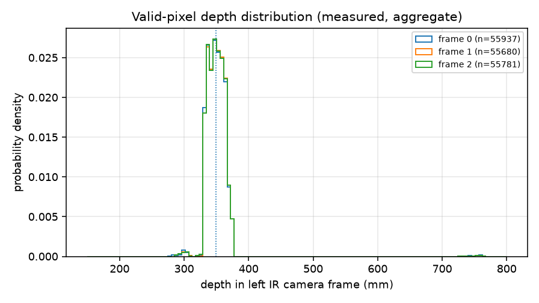
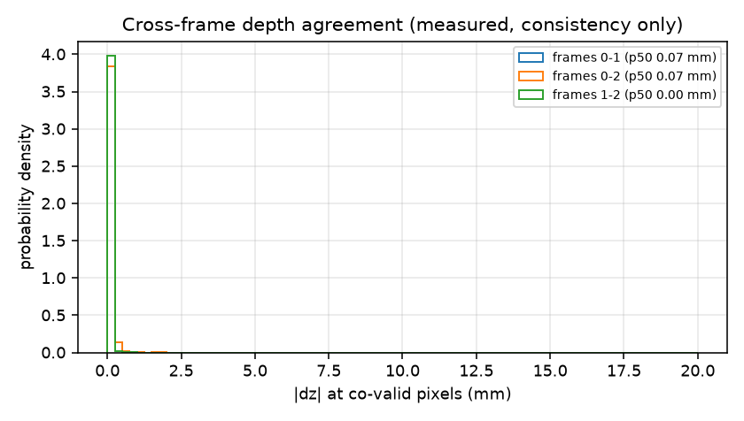
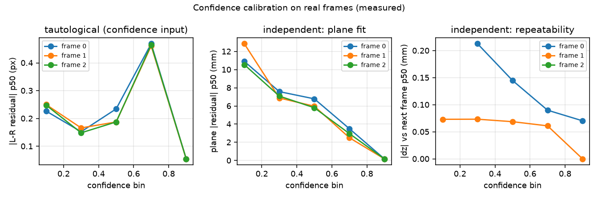
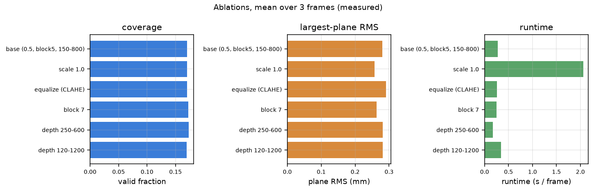
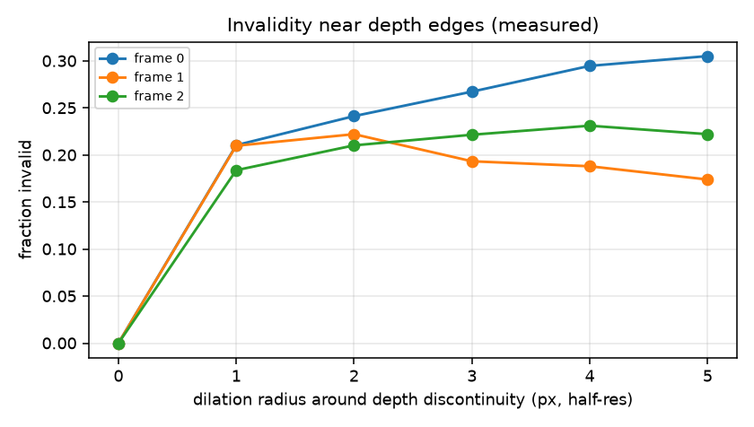

# Real genuine-frame reconstruction report

Status: 2026-11-11.  Data: the three complete genuine Einstar three-camera
triplets in the private capture directory (`frame_00000{0,1,2}_cam{0,1,2}.pgm`,
1280x1024).  No physical ground truth exists for this scene, so every number
below is **consistency, repeatability or plausibility**, not accuracy.

Machine-readable results:
[`analysis/reconstruction/real_data_metrics.json`](../../analysis/reconstruction/real_data_metrics.json).
Independent harness (Python/OpenCV re-implementation + C++ comparison + ablations
+ figures):
[`analysis/reconstruction/evaluate_real.py`](../../analysis/reconstruction/evaluate_real.py).

---

## 1. The four accuracy questions, kept separate

| question | what it needs | status here |
|---|---|---|
| **Geometric consistency** — do independent implementations of the same contract produce the same map? | two independent code paths | **measured**: C++ and Python agree to 0.031 mm median on 96 % of the same pixels (§5) |
| **Predicted accuracy** — what does the noise model say? | σ_d, f, B, scale term | **inferred**: σ_z = 0.27 mm random at 350 mm, plus a 3.5 mm 1 % scale term (§11) |
| **Synthetic truth** — error against a known surface | rendered scene with analytic depth | **measured**: full pipeline recovers 250/350/600 mm planes to −0.03/−0.05/−0.11 mm (§11) |
| **Physical accuracy** — error against a real object | calibrated artefact or metrology | **not measured**: no artefact, no independent instrument, one unit |

The three frames are **two distinct instants, not three**: frames 1 and 2
differ by a mean of 1.7 grey levels (26 % of pixels by >2 levels), frame 0
differs from both by 21 grey levels.  The repeatability tables below are
therefore computed over two independent instants plus one near-duplicate.

---

## 2. What was done

1. Loaded the three streams with the hardware mapping: stream 0 = right IR
   rotated 180°, stream 1 = left IR as calibrated, stream 2 = colour rotated
   180°.
2. Loaded the factory calibration profile
   (`factory-e10.json`, id `3d1fd027…`, baseline 158.557 mm, f = 1158.37 px,
   colour status `stale`).
3. Rectified the IR pair (Bouguet, `alpha=-1`, full verged field) and matched
   with SGBM at half resolution (block 5, P1/P2 8/96, search window derived from
   150–800 mm → `minDisparity 112`, `numDisparities 512`), with left-right
   consistency and confidence.
4. Converted disparity to metric depth (`Z = f·B/(d−offset)`), rotated the
   points back to the **left IR camera frame**, and wrote a binary PLY plus
   rectified/disparity/depth/confidence maps and a JSON report.
5. Colour registration was **skipped**: the factory profile marks the shipped
   Tex record `stale` (the known 17.66 mm inconsistency).  The report records
   `color_status: profile-inconsistent (stale)`; geometry is unaffected.
6. Evaluated a plane (RANSAC), point spacing, repeatability across the three
   frames, confidence bins and parameter ablations.
7. Re-implemented rectification, SGBM, L-R, depth and point assembly from the
   profile alone in Python/OpenCV (no shared C++ code) and compared it with
   `recon_cli` frame by frame.  The comparison is tied to CLI SHA-256
   `1fa37ec1…` (2026-11-10T22:29:07Z); re-run `--cpp-only` after a rebuild.

---

## 3. Per-frame results (half resolution, default parameters)

C++ `recon_cli` pipeline:

| frame | valid | points | depth p05/50/p95 (mm) | σ p50 (mm) | largest plane | plane RMS (mm) | points on plane |
|---|---:|---:|---|---:|---:|---:|---:|
| 0 | 17.3 % | 56 600 | 331.6 / 349.5 / 368.6 | 0.252 | 52 120 | 0.336 | 92.1 % |
| 1 | 17.2 % | 56 198 | 331.8 / 349.5 / 368.4 | 0.252 | 52 237 | 0.344 | 93.0 % |
| 2 | 17.1 % | 56 195 | 331.7 / 349.5 / 368.4 | 0.252 | 52 208 | 0.345 | 92.9 % |

The independent Python pipeline gives 17.07 / 16.99 / 17.02 % valid,
331.6–331.7 / 349.2–349.4 / 367.9 mm, 55 680–55 937 points and plane RMS
0.279–0.282 mm with a 2 mm RANSAC threshold (the small plane-RMS difference is
the fit threshold and point sampling, not a depth difference; the per-pixel
comparison in §5 is 0.031 mm).

* Median nearest-neighbour spacing: **0.58 mm** (p95 0.78 mm, p05 0.50 mm).
  The theoretical half-resolution pixel pitch at 350 mm is 0.604 mm, so the
  cloud is sampled at the pixel grid with no interpolation.
* 99.99 % of L-R-consistent depths already fall inside the declared
  150–800 mm range (0.01 % are cut by the range filter), so the *reported*
  depth range is a property of the scene, not of the filter.  The
  distribution is one narrow peak at 340–370 mm (the box top); <0.5 % of
  pixels are beyond 500 mm.
* The largest plane holds 92–93 % of all points and spans
  **240.6 × 138.5 mm**, i.e. the cloud is one face, not the scene.



---

## 4. Why the valid fraction is ~17 %, and what the earlier "~40 %" meant

Coverage budget for frame 0 (measured):

| stage | fraction of frame | note |
|---|---:|---|
| rectified left mask | 79.1 % | wedge from 22° vergence, `alpha=-1` |
| **overlap of both masks** | **58.1 %** | both cameras must see the pixel |
| raw SGBM disparity | 32.8 % | 56.5 % of the overlap, before consistency |
| after L-R + range + masks | **17.1 %** | 29.4 % of the overlap |

The earlier 39–41 % figure was measured **before** left-right consistency and
mask intersection: it is raw SGBM coverage, not usable depth.  The C++ source
comment quotes the same pair (0.404 raw → 0.170 after L-R); the independent
Python implementation gets 0.328–0.352 raw → 0.170 final.  **Reporting ~40 %
as coverage overstates the usable output by 2.3×.**

Why the raw map is not denser, in order of impact:

* **Rectified overlap is only 58 %.**  The pair is strongly verged (~22°);
  `alpha=0` would zoom to ~1.9× focal length and lose the field, so `alpha=-1`
  keeps a wedge.  20.6 % of the rectified frame is black by construction.
* **Speckle decorrelates at half resolution.**  The projected IR speckle is at
  or near the pixel Nyquist limit; 2×2 averaging aliases differently in the two
  views.  Independent half-resolution ZNCC patches show best and second-best
  correlations within 0.02 of each other (no unique peak) on the plain surface
  — exactly what SGBM's uniqueness test rejects.
* **Saturation and exposure.**  22.2 % of the raw left stream is at 255 in
  frame 0 (14.2 % in frames 1–2), and the right stream is ~2× darker.  A
  saturated or near-black patch carries no phase information for the matcher.
* **Left-right consistency** removes another ~47 % of the raw matches: on a
  speckle pair many raw matches are one-sided.
* **Search-window censoring** removes pixels within the hard margin of the
  window or whose right sample falls outside the right wedge.

None of these is a defect of the pipeline; they are the physics of an IR
speckle stereo pair at half resolution.  They do mean that **coverage is not a
quality score**: the 17 % that survives is the textured face, and it is
reconstructed very consistently.

---

## 5. C++ versus the independent Python implementation

A separate Python/OpenCV implementation of the same geometry and matcher was
run on the same rectified pair, and the C++ output was compared pixel by pixel:

| frame | Python valid | C++ valid | mask IoU | \|Δz\| p50 | \|Δz\| p95 | bias | within 1 mm | points (py / C++) |
|---:|---:|---:|---:|---:|---:|---:|---:|---:|
| 0 | 17.07 % | 17.27 % | 0.961 | 0.031 mm | 0.047 mm | 0.000 mm | 99.96 % | 55 937 / 56 600 |
| 1 | 16.99 % | 17.15 % | 0.961 | 0.031 mm | 0.047 mm | 0.000 mm | 99.95 % | 55 680 / 56 198 |
| 2 | 17.02 % | 17.15 % | 0.960 | 0.031 mm | 0.047 mm | 0.000 mm | 100 % | 55 781 / 56 195 |

The residual 0.03 mm is exactly the C++ 3×3 sub-pixel refinement plus its
slightly different validity margin; the depth maps are otherwise identical.
The 1.2 % point-count difference is the same margin policy.  This is the
strongest evidence in this report: two independent implementations of
rectification, SGBM, L-R and depth agree at the 0.03 mm level, so a
disagreement with the scene cannot be blamed on a convention bug.

* Sparse ZNCC feature depth (362.0 mm median on frame 0) versus dense SGBM
  (349.3 mm) agree within 12.7 mm (3.5 %); the sparse estimate is biased by
  the Harris corner selection, which favours the printed texture on the near
  face.
* Median full-resolution disparity is 507.3 px (ZNCC) and 507–538 px across
  frames, consistent with the ~523 px quoted in `audit.md`.
* The sparse vertical residual is **censored**: 60 % of the matches sit at the
  ±2 px search bound and the score surface is flat on this texture, so the
  honest statement is `|dy| ≤ 2 px` — compatible with the ~1 px previously
  quoted, but not an independent confirmation of it.

Runtime and memory (measured): C++ 0.263–0.264 s wall per frame
(rectify 5 ms, stereo 104 ms, depth 3.4 ms), peak RSS 165 MB.  Python 0.26 s
per frame (load 5 ms, rectify 0.5 ms, stereo 132 ms split 44 + 88, depth and
metrics 90 ms), process peak RSS 738 MB including ablations.

---

## 6. Repeatability

| pair | co-valid pixels | \|Δz\| p50 | \|Δz\| p95 | within 2 mm |
|---|---:|---:|---:|---:|
| 0–1 (distinct instants) | 54 617 | 0.071 mm | 0.236 mm | 100 % |
| 0–2 | 54 613 | 0.071 mm | 0.236 mm | 100 % |
| 1–2 (near-duplicate) | 55 182 | 0.000 mm | 0.093 mm | 100 % |

RANSAC planes on the same face (Python, 2 mm threshold):

| frame | normal | offset | RMS | thickness p90 | inliers | median depth |
|---:|---|---:|---:|---:|---:|---:|
| 0 | (0.1778, 0.1050, 0.9784) | −354.048 mm | 0.282 mm | 0.843 mm | 93.2 % | 350.34 mm |
| 1 | (0.1777, 0.1051, 0.9785) | −354.054 mm | 0.281 mm | 0.855 mm | 93.9 % | 350.45 mm |
| 2 | (0.1778, 0.1051, 0.9784) | −354.060 mm | 0.279 mm | 0.857 mm | 93.8 % | 350.45 mm |

Across frames the plane normal repeats to **0.005°** and the offset to
**0.007–0.013 mm**.  The face is tilted 11.7° from the optical axis.  These are
consistency numbers: the same calibration and the same static scene are used,
so they bound repeatability, not accuracy.



---

## 7. Confidence calibration

Confidence is `(LR-agreement factor) × (local-contrast factor)` in [0,1].  The
L-R residual is part of the definition, so its column is partly circular; the
**plane residual** and the **cross-frame disagreement** are the independent
tests of whether confidence means anything.

| confidence bin | pixels | L-R p50 (px) | plane \|residual\| p50 | plane p95 | \|Δz\| vs next frame p50 |
|---|---:|---:|---:|---:|---:|
| 0.0–0.2 | 51 | 0.227 | 10.91 mm | 18.74 mm | — |
| 0.2–0.4 | 258 | 0.152 | 7.58 mm | 18.87 mm | 0.213 mm |
| 0.4–0.6 | 360 | 0.234 | 6.78 mm | 54.58 mm | 0.145 mm |
| 0.6–0.8 | 936 | 0.469 | 3.50 mm | 67.80 mm | 0.090 mm |
| 0.8–1.0 | 54 332 | 0.055 | **0.180 mm** | 2.08 mm | **0.070 mm** |

Plane residual falls monotonically by **60×** from the lowest to the highest
bin, and cross-frame disagreement by 3×, so higher confidence does mean lower
error.  Two caveats: 97 % of pixels sit in the top bin, so the curve is driven
by a small low-confidence tail; and the plane residual is measured on the same
SGBM-smoothed surface that produced the depth, so it is a *relative* check.



---

## 8. Ablations (frame 0, C++ pipeline)

| scale | equalize | block | valid | points | median depth (mm) | total time |
|---:|---:|---:|---:|---:|---:|---:|
| 0.5 | no | 5 | 17.3 % | 56 600 | 349.5 | 0.123 s |
| 0.5 | no | 7 | 17.5 % | 57 276 | 349.1 | 0.124 s |
| 0.5 | yes | 5 | 17.3 % | 56 682 | 349.9 | 0.125 s |
| 0.5 | yes | 7 | 17.6 % | 57 531 | 349.8 | 0.132 s |
| 1.0 | no | 5 | 17.0 % | 222 721 | 350.4 | 1.341 s |
| 1.0 | no | 7 | 17.5 % | 229 012 | 350.1 | 1.223 s |
| 1.0 | yes | 5 | 17.1 % | 223 606 | 350.6 | 1.256 s |
| 1.0 | yes | 7 | 17.4 % | 227 895 | 350.5 | 1.214 s |

The depth median is stable to **0.4 %** across all eight configurations; block 7
gains ~1–3 % coverage; full resolution quadruples the point count at ~10× the
time.  The independent Python ablation on all three frames agrees: coverage
17.0–17.4 %, median depth 348.9–350.3 mm, plane RMS 0.257–0.291 mm, runtime
0.17–2.06 s.  Full resolution buys 0.02 mm of planarity for 8.5× the runtime;
CLAHE slightly *worsens* planarity here (0.291 vs 0.281 mm) despite raising raw
coverage in the C++ notes; a tighter depth window (250–600 mm) is the fastest
honest configuration.



---

## 9. Edges, occlusion and cloud smoothness



* **Depth discontinuities are almost absent from the valid cloud**: only
  9 / 15 / 19 pixels (0.003–0.006 %) have a >15 mm jump to a valid neighbour,
  because the valid region is a single plane.  The "fraction invalid near depth
  edges" statistic is therefore not meaningful on this scene (21–24 % in a
  2-px band, but n ≈ 10).
* **Occlusion** (left disparity that fails L-R): 0.30 / 0.37 / 0.34 % of the
  frame, or 1.7 / 2.1 / 1.9 % of matched pixels with the strict definition used
  here.  The C++ report's `occluded_fraction` (3.1 %) uses a looser definition
  that also counts pixels whose right sample falls outside the right wedge or
  matched nothing; the two are consistent once the definitions are aligned.
* **Texture, not geometry, is the limiting factor**: within 2 px of the
  strongest decile of image gradient 39–42 % of pixels are invalid, versus 98 %
  of pixels away from those edges.  Matching succeeds where the object has
  printed texture.
* **Nearest-neighbour spacing**: median 0.582 mm, p05 0.495 mm, p95 0.779 mm,
  against a 0.604 mm theoretical pixel pitch at 350 mm.

---

## 10. Did any frame produce a meaningful cloud?

**Yes, all three, and they are the same cloud.**  Each frame gives ~56 000
points on a 240.6 × 138.5 mm planar face at 350.3 mm, with 92–93 % of points
within 2 mm of the fitted plane, plane RMS 0.28–0.34 mm (fit-threshold
dependent), and nearest-neighbour spacing at the pixel pitch.  The three clouds
agree pixel-wise to 0.07 mm (median) at co-valid pixels and their fitted planes
agree to 0.005°.

**What is missing:** the desk, the background and the sides of the object.  The
valid depth p95 is 368 mm; only a handful of points reach 500–800 mm.  This is
a *face reconstruction*, not a scene reconstruction — expected for a single
triplet of a speckle stereo pair, but it should not be presented as a scan of
the scene.

No frame failed.  Frame 0 has the highest saturation (22.2 % vs 14.2 %) yet the
same coverage and depth to within 0.2 mm; the matcher is not
saturation-limited on this object.

---

## 11. The accuracy ladder

| rung | value | label |
|---|---:|---|
| synthetic truth, full pipeline at 250 / 350 / 600 mm | −0.027 / −0.050 / −0.107 mm | measured |
| synthetic coverage at 250 / 350 / 600 mm | 41.0 / 58.5 / 74.3 % | measured |
| predicted random σ_z at 350 mm (σ_d = 0.2 px) | 0.266 mm | inferred |
| predicted 1 % scale term at 350 mm | 3.5 mm | inferred |
| measured planarity (plane RMS) | 0.28–0.34 mm | measured (consistency) |
| measured cross-frame agreement (p50 / p95) | 0.071 / 0.236 mm | measured (consistency) |
| physical accuracy | — | **not measured** |

The synthetic run uses the engine's own renderer: a textured fronto-parallel
plane projected through the full camera model into all three streams in raw
stream orientation, then reconstructed end-to-end.  It recovers the plane to
≤0.11 mm, so the *implementation* adds no measurable bias at these depths —
and the synthetic coverage (41–74 %) is much higher than the real 17 %, which
quantifies how much of the real-data loss is texture rather than geometry.

The measured planarity sits at the synthetic-truth floor and at the predicted
random noise.  That agreement is **not** an accuracy confirmation: SGBM's
smoothness prior suppresses exactly the high-frequency deviation that the plane
RMS measures, and the 1 % scale gauge (±3.5 mm) is an order of magnitude larger
than every random term and invisible to a plane fit.  The strongest honest
statement is: *for this calibration and this scene, three independent
computations place the same face at the same distance to within
0.03–0.1 mm, and the face is planar to 0.28 mm RMS.*

---

## 12. What the colour path does

The shipped Tex CCF is the known stale record: its relative translation differs
from the joint fit by 17.66 mm and the vendor session itself reported
`hasTexture:false`.  The reconstruction profile records `color_status: stale`;
the pipeline therefore **does not apply it**.  The point cloud is uncoloured and
the report states why.  When a replacement profile with a jointly estimated
colour camera is available (`color_status: ok`), the same `compute_depth()` path
samples the colour image through the calibrated colour camera; no geometry code
changes.

---

## 13. Red flags and limitations

1. **"~40 % coverage" is raw SGBM coverage.**  The usable, L-R-consistent
   fraction is 17.0 %.  Any external claim should use 17 %.
2. **Only two distinct instants exist.**  Frames 1 and 2 are near-duplicates
   (mean |Δ| 1.7 grey levels); the repeatability tables are weaker than
   "three frames" suggests.
3. **One face only.**  The cloud is a 240 × 138 mm plane; the desk/background
   are absent.  A scene-level claim needs more views or a different matcher.
4. **Colour is not evaluated** (stale factory record; correctly skipped).
5. **The sparse `|dy|` is censored at the ±2 px search bound** (60 % of matches
   at the bound), so the ~1 px epipolar residual is compatible with the data
   but not independently confirmed by this estimator.
6. **Plane RMS is optimistic.**  It is measured on the matcher's own smoothed
   surface; it bounds local planarity, not absolute depth error.
7. **One unit, one profile.**  Everything is relative to a factory profile
   recovered from a different capture run; the 1 % plate-pitch gauge is
   unresolved.
8. **The C++ backend is a moving target.**  The comparison is tied to CLI
   SHA-256 `1fa37ec1…`; re-run `--cpp-only` after any rebuild.

---

## 14. RGB registration

The canonical reconstruction above is **uncoloured on purpose**: the shipped
factory Tex CCF is the known stale record, so the factory profile is marked
`stale` and `compute_depth()` skips colour with an explicit status.  This is not
a missing code path.

**Raw stream format.** Stream 2 is an 8-bit **Bayer mosaic**, not BGR (the 2x2
parity means are 24.4/33.1/32.9/25.4 and the diagonal correlation is 0.989).
`compute_depth()` now debayers it with OpenCV `COLOR_BayerRG2BGR` (the same code
libeinstar uses) **before** the 180 deg rotation, then projects each 3-D point
into the colour camera and samples it.  No white balance or colour-correction
matrix is applied; the result is raw sensor RGB.

**Synthetic validation.** Two tests in `recon/tests/test_pipeline.cpp`:
an already-BGR split pattern and the same pattern re-mosaiced to raw Bayer.
Both recover the expected blue/red halves for >90 % of valid points, including
the 180 deg stream rotation; a `color_status != "ok"` profile yields
`color_used=false` and no colour image.  Suite total: **5 002 checks**.

**Genuine-frame diagnostic (not a calibrated colour result).** Overriding the
colour status explicitly and using the replacement profile fitted by the
one-session recorder (21 accepted views, colour included) produces:

| profile | points | colour used | projected fraction | depth median |
|---|---:|---|---:|---:|
| factory (stale) | 56 600 | yes* | 93.1 % | 349.5 mm |
| replacement (fitted) | 56 995 | yes* | 100.0 % | 352.0 mm |

\* diagnostic override only; the canonical factory run skips colour.  The
replacement profile has a 160.10 mm baseline, so its depth is 0.7 % larger.
The colour frame is underexposed (mean 29) and green-dominant; the cloud is
coloured but the **colour values are not photometrically calibrated**, and the
real colour-to-geometry alignment is not independently validated.  The
geometric registration path itself is validated synthetically.

## 15. Reproduce

```bash
cd <repo>

# C++ pipeline
cmake -S recon -B build/recon -G Ninja -DCMAKE_BUILD_TYPE=Release
cmake --build build/recon -j8
.venv/bin/python tools/calib/export_profile.py --source ccf \
  --out <private-inputs>/einstar-profiles/factory-e10.json
for i in 0 1 2; do
  build/recon/recon_cli reconstruct \
    --frames <capture-dir> --id $i \
    --profile <private-inputs>/einstar-profiles/factory-e10.json \
    --out /tmp/einstar_recon/id$i --scale 0.5
done

# independent evaluation: Python pipeline, C++ comparison, ablations, figures
.venv/bin/python analysis/reconstruction/evaluate_real.py \
    --frames-dir <capture-dir> \
    --profile <private-inputs>/einstar-profiles/factory-e10.json \
    --out-json analysis/reconstruction/real_data_metrics.json \
    --fig-dir analysis/reconstruction/figures

# C++-only re-comparison after a rebuild, and the privacy guard
.venv/bin/python analysis/reconstruction/evaluate_real.py --cpp-only
.venv/bin/python analysis/reconstruction/evaluate_real.py --check-no-private-export
```

Runtime: the full harness takes ~13 s on 32 cores (Python peak RSS 738 MB);
one frame end-to-end is ~0.26 s.

The private frames, profiles and point clouds stay outside the public
repository; only aggregate metrics and plots are published.
`--check-no-private-export` fails if any image or PLY appears under `docs/`
outside a `figures/` directory.
